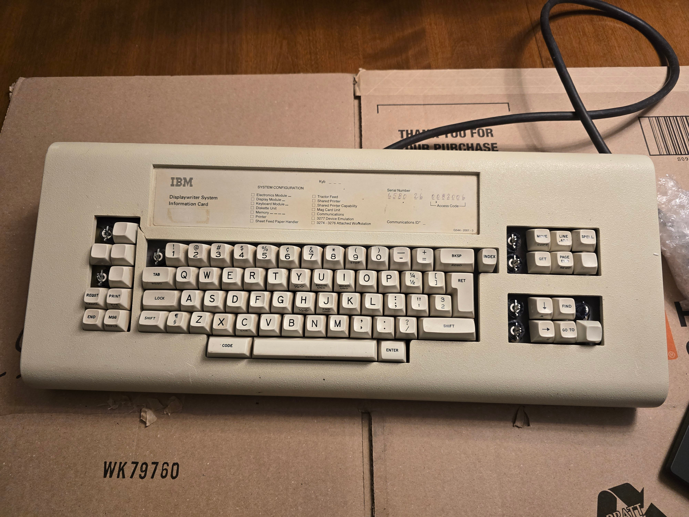

# DisplayWriter Restoration Project 2026

This is a write-up with photos of my process to restore a vintage IBM DisplayWriter Beam Spring
keyboard.  The intent is to document the specific process I used, write down how I dealt with some of the
specific challenges I encountered with this board, and provide something of a guide for others
attempting similar projects.  There exist other write-ups of beam spring keyboard restorations;
here I try to provide some additional detail, fill in some of the gaps in other write-ups, and
add in additional discoveries.

## Why?

Why, in 2026, am I spending so much time restoring a nearly-half-century-old keyboard?

As a long-time Model M user, I recently found out about the existence of beam spring keyboards, and knew I had
to give them a try.  The theoretical mechanics of the switch operation appeal to me.  In many ways, it seems to
be something of a "pure" version of what a keyboard switch "should" be, and I had to experience the type feel that
others have described.

I came across the Model F Labs project, and the easiest way to try a beam spring keyboard would be to order
one of their new reproduction keyboards.  Indeed, I have one on order!  But a few things kept gnawing at me
that led me to also want to restore an IBM original.

Ellipse's attention to detail appears to be remarkable, and testimonials have been very positive.  However,
a few reports describe that they don't quite match the feel - and definitely don't match the sound - of
the originals.  Notably, several users report that the reproduction beam spring switches are less smooth
than the originals.  I suspect this is an engineering trade-off related to Ellipse's efforts to shrink
the height of the switch while maintaining travel distance; it seems plausible that the reduced bearing
surface and reduced distance between stabilizing springs could impact the smoothness and "floating"
feeling I've heard described.  A shorter switch very clearly has numerous advantages in the modern world,
but I still felt like I needed to try an original.  And as soon as my MFL board arrives, I'll certainly
be posting reports on the comparison!

After deciding that I wanted to get a good original IBM beam spring keyboard, I had to determine which one.
I don't have the budget for a good-condition, fully-restored, or already-converted keyboard, so I found a
poor-condition unit on ebay that was in my price range.  I also have mixed feelings about removing working
keyboards from vintage computing systems, so the poor/for-parts condition of this keyboard made me feel a
bit better about that.

The keyboard I picked is the DisplayWriter keyboard.  The biggest reason is that is what I happened to find
in my price/condition range; but I probably would have picked a DisplayWriter regardless, just because its
layout can be most easily remapped to a modern one (minus the numpad, which I don't use much).

## Initial Keyboard Condition

The keyboard condition was listed as 'Used', but it would be more accurate to call it heavily-damaged, possibly
in the "for-parts" range.  The blurry ebay pictures showed several missing key caps, a crack in the case,
and a damaged connector; but not much else could be seen.

After the white whale arrived and I started a more detailed examination, it became clear that the keyboard had suffered a
catastrophic fall at some point in the past.  Based on the damage, it likely fell from a decent height,
landed at an angle on its face, then clattered around causing significantly more damage.  When it arrived,
the internals had shifted such that the case was impacting the keys on the bottom and left-hand
sides of the keyboard.

The damage included:

- 8 missing key caps
- 2 chipped key caps
- Badly bent up base pan and brackets
- Switch assembly wrenched out of bracket, twisting its metal tabs
- Crack clean through the case in one of the section dividers
- A number of badly bent switch stems
- A number of damaged switch sliders, including a few practically shattered
- A few miscellaneous other damaged switch components like a bent up return spring and sliced o-rings
- All the fun age-related deterioration associated with these boards

It was also quite dirty, but that is to be expected.  And the worst of the mess came from deteriorating
components of the keyboard itself; specifically the contamination shield and old foam.

The good news - there was practically no rust!  The base pan and switch plate were mostly corrosion-free;
just a couple isolated corrosion spots of stable dark-colored oxidation.  Rust treatment would have done
more harm than good, so I was able to avoid evapo-rust for the whole project; instead opting for spot
treatments to encapsulate the isolated small corrosion spots.  Silver linings!

## Restoration Objectives

I had two major objectives with this restoration:

1. Get an actual, functional, working keyboard that can be viably used as a daily-driver in a modern environment.
2. Preserve as much original history as possible.

I do enjoy the vintage nature of the keyboard and see it as something of a museum piece.  But I do intend to use
it extensively; so restoration decisions cannot compromise usability.  If usability ever directly conflicted with
historical preservation, I usually made the choice to prioritize usability.

The most difficult decision to make with the trade-off here was whether or not to retain the original caps-lock
mechanism.  The DisplayWriter has a cool and unique mechanical lock mechanism that would be very neat to preserve.
However, that key is an ideal place for a 'Ctrl' key, so I made the decision to remove the locking mechanism
and treat it as a normal switch.  But no permanent modifications are made and I'm retaining the original parts, so
it can always be reinstalled in the future.

In general, I wanted to make as few compromises as I possibly could.  After all, if a main reason to get such a
vintage keyboard is to have an original point of reference against modern reproductions, it's not really a fair
comparison unless it's restored to its best possible condition.  And this philosophy ended up costing me a lot
of additional time, as well as going in a few different directions from other restoration projects; though I hope the
result is worth it, and hopefully some of this work can benefit other restorers!

I also decided early-on to take an extreme amount of care during this restoration.  Reading other restoration reports,
damage (especially to the switches) is very common during such projects.  With the number of heavily-damaged switches
I already had, I couldn't afford to damage any more; so I developed some techniques for performing some operations
in a more controlled manner.  I believe it paid off.  Not only did I cause zero additional damage during any of
the procedures, but after all was said and done, I only ended up with a single non-functional switch from the original
set.

## A note about cleaning chemicals and processes

I have on hand a fair array of various solvents, oils, and cleaning chemicals; but for this project, I decided to
be more conservative.  These are historical materials, often of unknown composition, and sometimes made more
brittle or sensitive with age.

When I had a choice between using a more powerful chemical versus a less powerful one plus more time/elbow grease,
I usually picked the latter.  Unless I encountered particularly stubborn issues, most parts were cleaned with a
weak dish soap solution and a soft toothbrush or rag.

