# DisplayWriter Restoration: Disassembly

Of course, the first step is taking everything apart.  Most of the steps here are pretty straightforward, but there
are a couple gotchas to be aware of.

## Keeping Organized

There aren't *that* many different components involved in the DisplayWriter, but it's still important to stay organized
and keep relevant components together.  I used a spare set of plastic component drawers for most parts.

## Removing the Case

The outer case is a thick plastic and should be removed first.  The case is attached with 4 screws from the bottom.

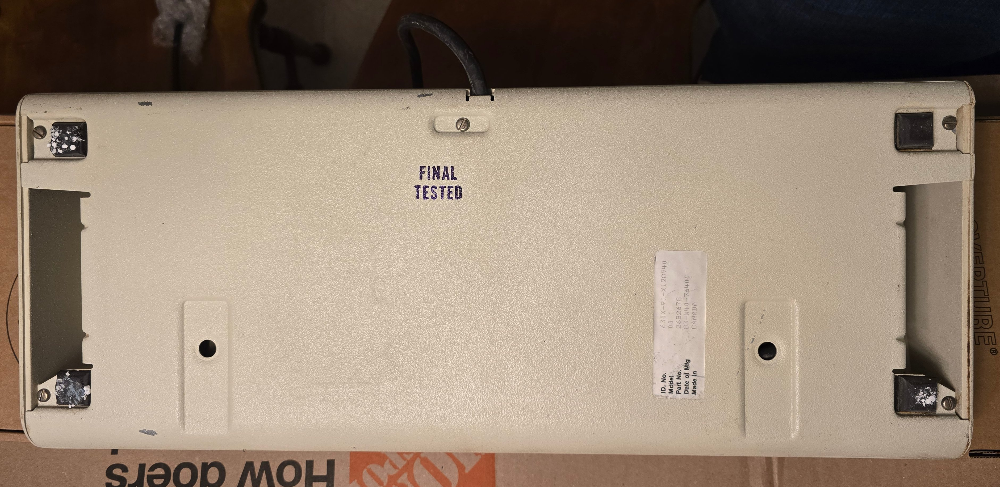

These are the 4 screws near the feet.  The one by the cord can stay for now, it's for the cable tension relief.

For working on the bottom, I put the DisplayWriter on 2 boxes at the edges so it's not resting directly on the keys.

After the screws are removed, at this point, you should be able to lift the base pan (with the rest of the keyboard)
upward and out of the case and place it back on its feet.  But be careful -

In my case, the fall suffered by the unit dislodged some of the internal attachments, and the switch assembly was being
partially retained by the case itself.  When I tried to lift the base pan out, the switch assembly nearly fell out the
bottom.  Luckily I caught this before it caused any more damage, but it's something to watch out for.

## Removing the Controller

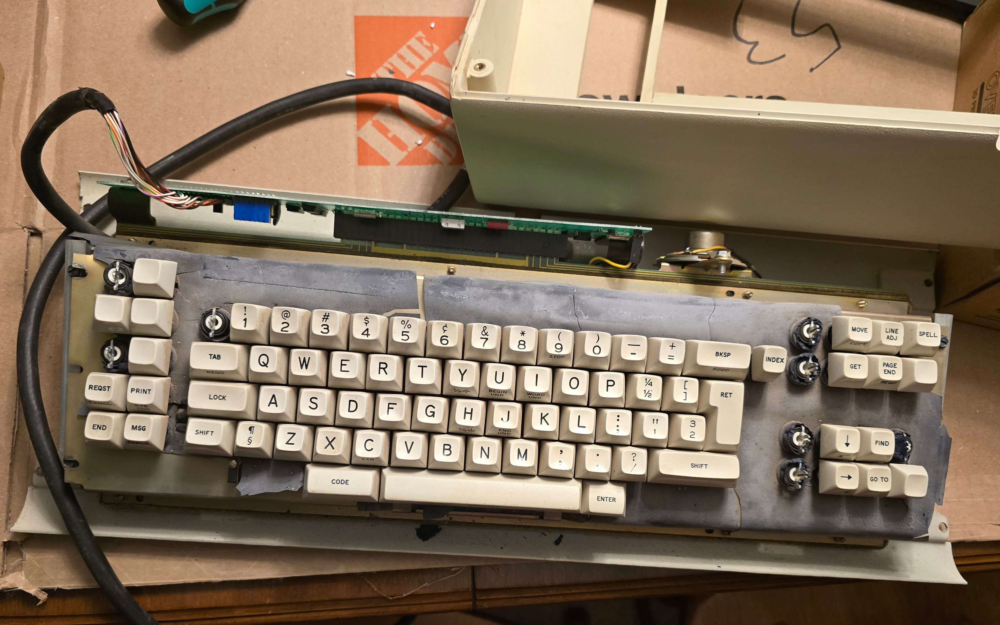

In my case, I'm replacing the controller with a modern USB controller.  But I still wanted to preserve the old one in
case it ever needs to work with an original DisplayWriter system again.

The speaker and the cable both attach to the controller with pin headers and easily pull off.  The cable itself is held
in place with a clip screwed to the bottom and can easily be removed.

As an aside, missing insulation on this section of the cable is not damage.  It's intentionally left off here so the
cable shield grounds against the base pan.

The controller board is held in place with 2 screws to the bent metal brackets.  After these screws are removed, it pulls
straight off of the pad card edge.  It needs to be pulled off at a slight angle, matching the angle of the switch assembly.
It was quite difficult to pull off in my case, but I was able to remove it using a *very* slight and gently wiggling motion.

A nice side-effect of this tightness is that removing the controller wiped the card edge contacts and left nice, shiny copper!

## Removing Keycaps

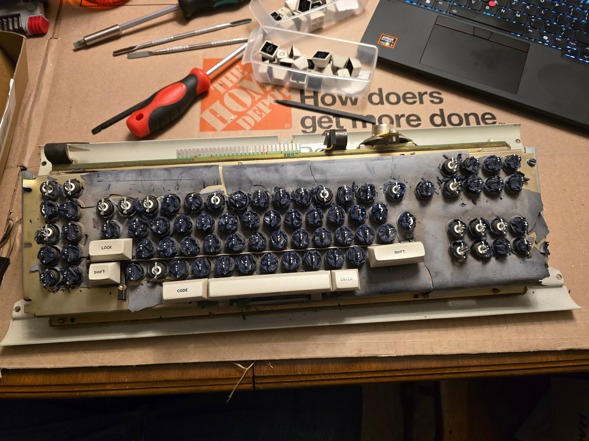

I started by removing the 1U keycaps.  These are not MX key caps and require a slightly different technique to remove.

A normal wire keycap puller can be used.  The things to keep in mind for the normal keys are:

- Pull upwards roughly perpendicular to the base pan, *not* perpendicular to the tilted switch assembly.
- Don't just try to pull straight upward.  Use a slight, gentle front-to-back rocking motion.  You should be able to feel the key
  cap get a little further off the stem with each rocking motion.  Be very careful not to rock at all side-to-side.

The key stem and keycap attachment is an interesting design.  The metal tines provide some degree of elastic deformation which
likely results in a more consistent attachment with looser tolerances than the press-fit connection of MX stems.

I'd suggest removing all the "normal" key caps first.  On this keyboard, that is most of the 1U keys and some of the larger
keys as well.

Several of the larger keys have extended "feet" on the bottom designed to bottom out before the key can be tilted too much.  These
don't interfere with removal much, but on these keys, a wire keycap puller won't be able to get as much purchase.  It's still
possible to grip it and work the key cap loose.

A bit of additional care is also needed removing the LOCK key and both SHIFTs.  These keys are in proximity to the shift-lock
mechanism.  The keycaps can be removed normally; just make sure the wire puller isn't hooked on any of the flippers.

Leave the space bar until last.

## The Space Bar Mechanism

The space bar on the DisplayWriter has a unique stabilizer mechanism that doubles as a counterweight to help balance the
space bar weight.  I like the clever mechanism, even though it's a little clattery.

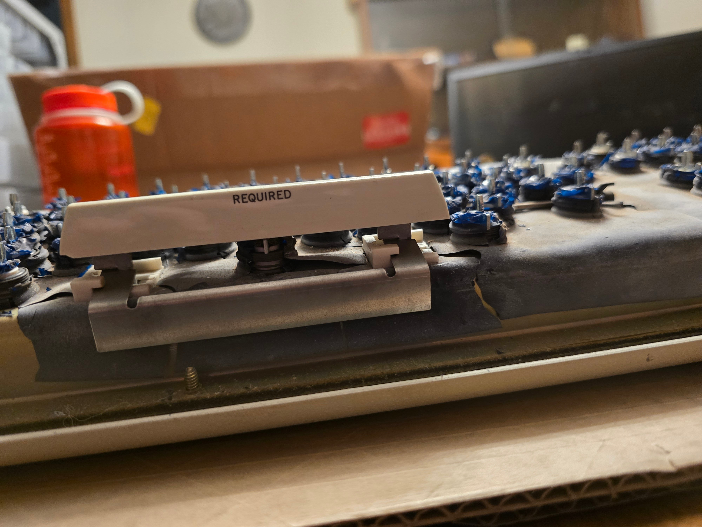

Contrary to some other guides, it's not necessary to remove every other keycap to access the space bar.  But if removing
all of them anyway, it's easiest to leave it until last.  If removing the space bar without doing a full disassembly, it's
necessary to first remove the outer case as well as the ENTER key.

The important thing to understand about the space bar keycap is that it doesn't actually attach to the switch like the other
keycaps.  The other keycaps have a tight socket designed to spring-fit on the metal stem; but the space bar socket is
intentionally completely loose on the stem.  The socket also has part of its left side missing; this is also intended,
not damage.

In the space bar, the switch itself provides three functions:

- The key press detection, of course
- The main return force for the space bar (augmented by the counterweight)
- Prevents the space bar from shifting laterally to the right

Notably, unlike all the other keys, the space bar switch is *not* what retains the keycap.  This is actually
performed by part of the stabilizer mechanism.  The keycap cannot be removed just by pulling it off the switch stem.

The space bar keycap itself contains 2 metal legs that are molded into the keycap.  The bottoms of these legs hook into
slots within the white plastic switch board inserts; and that is what actually retains the keycap.  To release them, the
space bar needs to be shifted to the right; but the switch stem normally prevents this.

Removing the space bar should require very little force, less than the other keys.  If you encounter resistance, there's
probably something wrong.

To remove the space bar, first press the switch itself down while holding the spacebar keycap up.  It's easiest to do this
with the case removed, accessing the switch from the front.  It can be done just with a finger, but a small tool of some
sort can make it a bit easier.  The switch should push down easily since it isn't actually attached to the keycap.

Then, with the switch held down, push the space bar to the right (while still holding it up).  It should slide a few
mm to the right, the pull straight up out of the plastic inserts.  This should require essentially no force.  Then the
stabilizer bar slides right off.

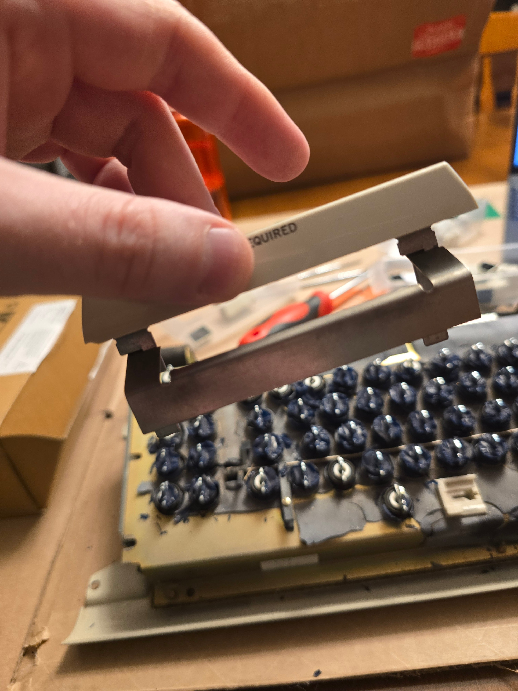

I didn't attempt to extract the metal legs from the plastic keycap; they appear to be molded in place.

## The Shift Lock Mechanism

The other unique mechanism that needs to be removed is the shift-lock mechanism.  This is the mechanical caps-lock that is
present on this board.

The LOCK key, when pressed, physically latches down and does not return.  It is reset by pressing either SHIFT key.

The LOCK key switch itself is mostly the same as the other key switches, but is missing its return spring.  In a beam spring
switch, this yields bi-stable operation, where the switch can be latched in either its upward or downward position.  Pressing
the key latches it in the downward position.

The mechanism that releases it using the SHIFT keys is based on interactions with the keycaps.

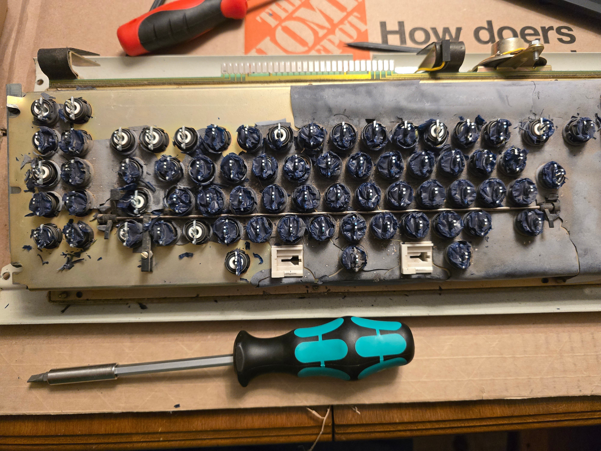

A metal bar spans the two SHIFT keys and has a plastic flipper at each end.  The left-hand flipper has 2 arms, one under SHIFT
and one under LOCK.  When either key is pressed, it pushes on the flipper, rotates the bar, and pushes up on the other keycap.
This causes the LOCK switch to be pushed back upward.  The right-hand flipper has only one arm, for the right SHIFT key.  These
flippers are firmly attached to the bar; likely press-fit, possibly with an adhesive.  I did not attempt to remove the flippers
from the bar.

There's an additional plastic piece wrapped around the bar near the left side.  This is a tensioner/resistance mechanism,
presumably intended to prevent this bar from rattling around during normal use.  The tensioner is attached to the switch
board with a screw as well as a nut that sits between the two tensioner legs.  The nut is what clamps the tensioner to
the switch board, and the distance between the screw and the nut sets the tension on the bar.  For normal operation, this
should be set just tight enough to prevent the bar from rattling on its own but not tight enough to feel noticeable resistance.

To remove the lock mechanism bar, first unscrew the tensioner from the board, but leave the plastic piece attached to the bar.
Next, the bar needs to be removed from the pivot points at each end.

I've seen other guides that suggest bending this bar to pull it out of the pivots at each end.  I'd recommend against that.  The
bar doesn't appear to be made out of any kind of spring steel and would likely deform plastically.

Both pivot points are attached with clips that clip into plastic inserts in the board, and both are removed by pulling straight
upward (perpendicular to the switch board).  This takes a bit of force to pull the clips out.

Be very careful pulling these clips out.  They're on long plastic legs that can break easily.  I'd recommend pulling one side out
at a time while holding the bar down near the other end.  (This does very slightly bend the bar, but much less than would be
required to pull the bar out of the pivots, and not enough for plastic deformation.)

## Cleaning Up Deteriorated Contamination Shield

Note: I originally cleaned up the shield before removing the shift lock mechanism since I couldn't see well enough to determine how to remove
it yet, so the pictures still show the shift lock mechanism in place.  I'd suggest removing the shift lock mechanism first - it will
make it easier to clean up the shield.

All the loose sheet-like debris seen in prior photos are remnants of the original contamination shield.  It seems that these have essentially
universally degraded into contamination by now.

There are two parts of this shield: Thin sheet material across the whole board, and individual blue "bags" twisted around each switch.  Both
had become very brittle and fragmented, with many bits getting inside the board and switches.  These all need to be removed.

I found the easiest way to remove the fragments was to start with wide-blade tweezers and pick off each of the individual blue bags, then the
large sheet fragments.  After most of the larger pieces were removed, I used a vacuum to clean up any loose small pieces, then
back to tweezers for remaining bits.

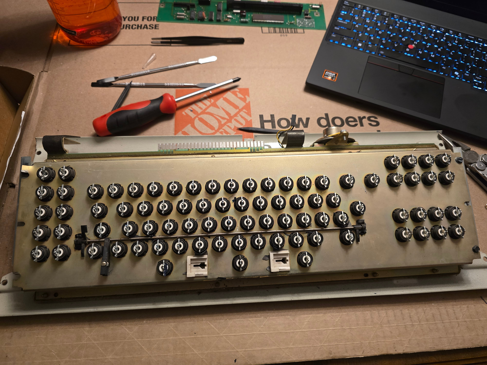

## Removing Switch Assembly

Before removing the switch assembly, first remove the speaker if present.  This is held on with a single screw and a metal clip.

The switch assembly is attached to the base pan with 4 screws.  In my case, due to the bad drop the keyboard suffered, the frame
had already been wrenched away from 2 of the screws and the metal plate bent; but this is likely atypical.

Remove all 4 screws using either a slotted screwdriver or a nut driver.  (I'd recommend the latter for this and other hex-head screws.)

The whole switch assembly then comes out.  The next steps involve opening it from the bottom, so I flipped it over and set the edges
on boxes to avoid resting it on the switches.

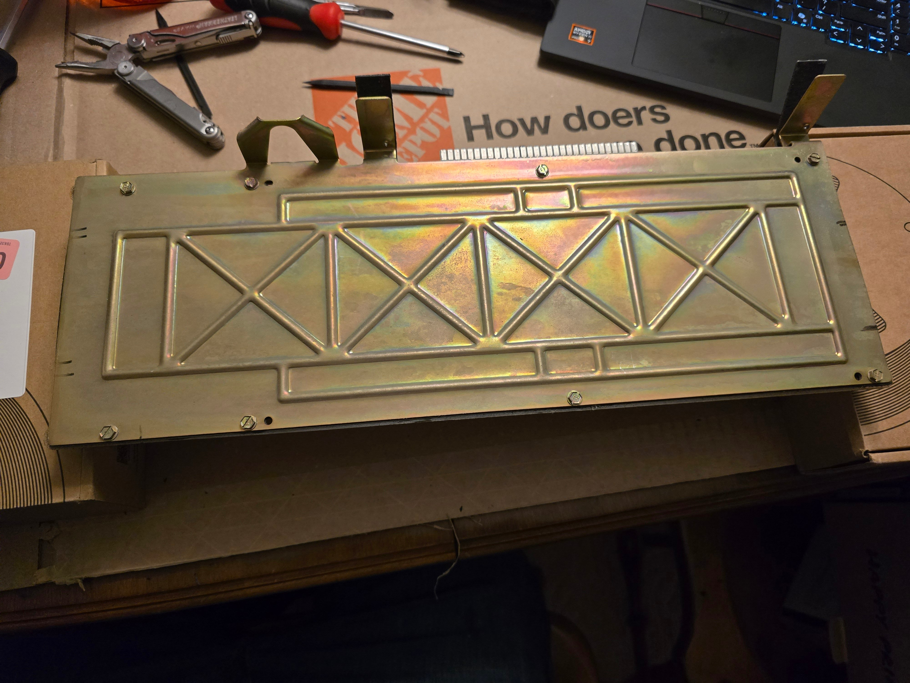

## Unpacking the Switch Assembly Sandwich

Next is digging into the switch assembly sandwich.  This is held together with 8 screws.  The slots on my screws were pretty shallow,
so as before, I'd suggest using a nut driver on the hex head.

After removing the screws, take off each layer, one at a time.  First is the metal back plate; it just lifts off.  It might be lightly
adhered to the "rubber" mat underneath; it's OK if the rubber mat comes off with it, but I held it down to peel off the layer separately.

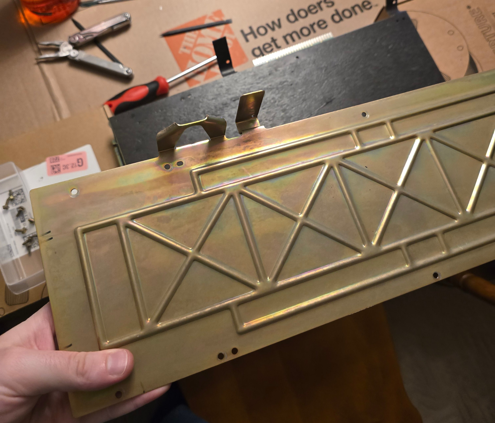

(I didn't add the black witness marks; not sure if these are from original manufacturing or subsequent maintenance.  They look like
sharpie, but weren't attacked at all by alcohol, so I left them.)

Next, the black rubber mat comes off.  I don't actually know what material this mat is; it's rubbery, but also appears to be somewhat
fibrous.  Regardless, it's actually held up pretty well over the years, so I was able to reuse it.  The mat might be lightly adhered
to the pad card PCB below.  Either carefully peel the mat off the PCB, or remove both together (lift straight up) and peel them
apart after.

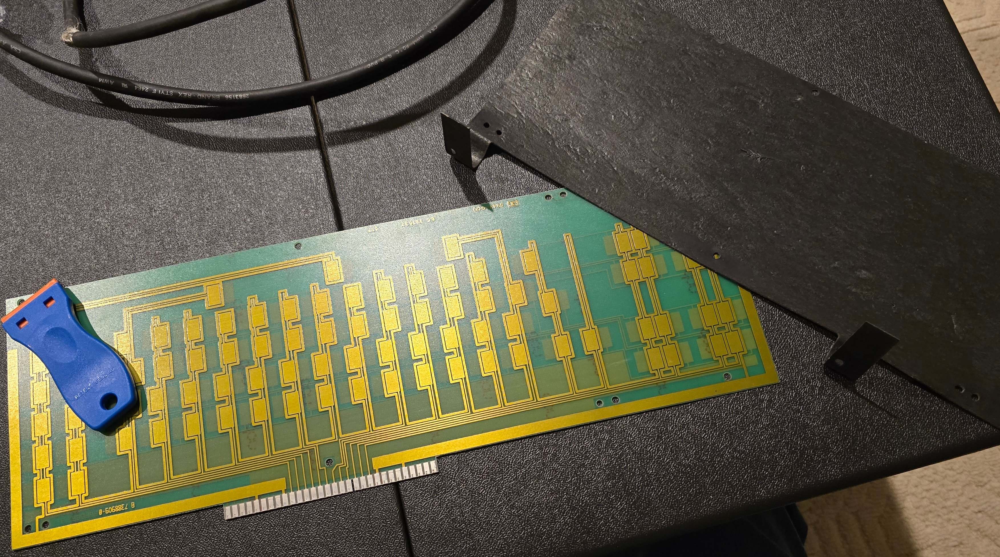

After revealing the pad card, I was immensely relieved to see that it was intact.  Given the extent of the other fall damage, and the
impact on the switches that would have transmitted to the pad card, I was quite nervous that it might be irreparably damaged.  Fortunately,
it was in quite good condition.  Although, ominously, there was a fragmented end of a beam spring stuck to it ...

Be careful handling the pad card.  It's thinner and more flexible than most modern PCBs.  I don't know exactly how much bending it
can handle without breaking, but I'd recommend carefully supporting it so it doesn't flex too much.

Beneath the pad card are the switches themselves.

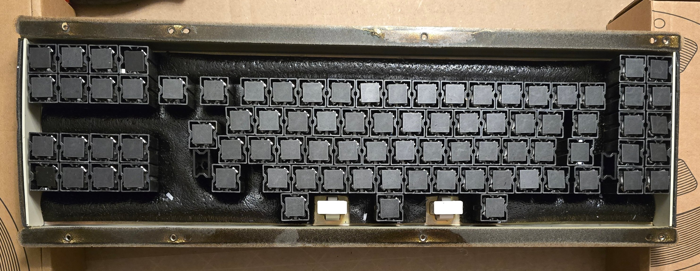

## Removing Plastic Gasket Strips and Side Pieces

The interface between the back plate and switch plate has 2 narrow plastic strips with holes for the screws.  There was also originally
a strip of foam underneath the clear plastic strips; but on my board, this had long-since deteriorated into a sticky mess.

I was able to separate the strips with a plastic razor blade, pretty much just obliterating the foam.  Go slowly, and be careful not
to bend the plastic strips too much or they might permanently kink.

Before removing the switches, I'd also recommend removing the plastic side pieces in the switch frame.  These have tabs that slot into
corresponding holes in the metal frame.  To remove, slightly bend them outward until you can pull the tabs out of the holes.  These
plastic pieces also have some of the "rubber" mat material glued to them.  I didn't determine how to remove these until after I had
already removed the switches, so the photos show a different order.

## Removing the Switches

Next up is removing each of the switches.

For this project, I decided to track each switch independently from beginning to end; so I removed them in scan order and made sure
to maintain that order all the way through the cleaning process.  I had a few reasons for this, but a big one was keeping track of
which switches were subject to impact damage, so this may be less important for others.

The switches are mostly loose at this point, and other guides recommend simply wiggling each one until it can be pulled out.  I
wanted to be a little more careful with it to avoid damaging the plastic clips in the switch housing that clip on top of the
switch plate.  These clips are angled on their top surface so they can be easily inserted without damaging them, but the bottom
face of the clips is flat, and just yanking them out will often damage these clips.

I ended up making a simple 3d printed tool that fits over the top of the switch and depresses its clips so the switch can be more
easily pulled out from behind.  The tool is essentially just a short hollow cylinder of the appropriate diameter.  Even with the
tool, it still helps to tilt the switch out by slightly rotating it on the axis that connects the 2 clips on the housing.  This helps
to extract the switch without the clips falling into the small gap between the tool and switch plate.  The small, black, cylindrical
tool is visible in the photo below.

In my case, a number of switches were broken and had loose internal components such as shards of shattered sliders.  As I removed each
switch, I gave it a gentle shake to determine if any pieces were rattling around inside.  If a switch sounded like it contained
small fragments that could get lost, I placed a piece of masking tape over the fly plate to contain them.

As another indicator of potential loose pieces inside of a switch (which can help differentiate between a switch leg that was already
broken versus damaged during removal), look at the bottoms of the white slider legs that are just visible at the edges of the fly
plate.  If the bottoms of both legs are visible and even, the slider legs are likely OK.  If one or both are missing, or they're
at uneven heights, something is broken.

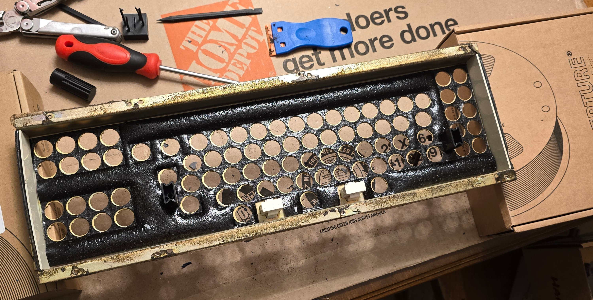

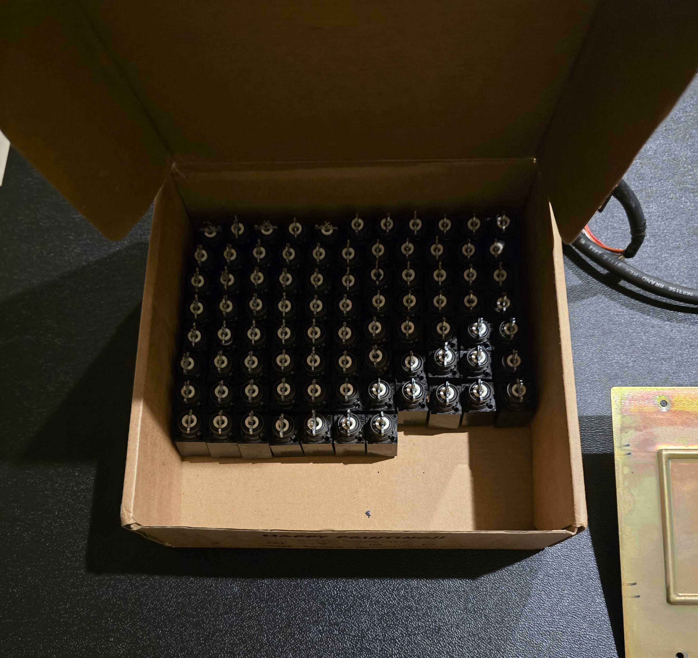

## Removing Plastic Inserts

The board has 4 plastic inserts; 2 each for the shift lock mechanism and space bar stabilizer.

The white space bar stabilizer inserts push out from the back of the switch board and come out through the front.  Each insert has 2
large clips that sit just under the switch board.  The inserts can be removed just by squeezing these clips and pushing the insert
through.  The clips nearest to the wall can be difficult to access - a slotted screwdriver works well here.

The black shift lock inserts come out the opposite way, pulled out through the back.  These are held in place with small black clips
that sit on top of the switch board.  These plastic inserts appear to have become fairly brittle over time.  Despite my best efforts
to properly depress these clips before removal, 3 of the 4 clips fatigued or snapped off during removal.  This isn't a big deal though;
the inserts are located by other pins on their top, and they're held in place by the switch assembly sandwich.  The clips are just
an assembly aid.

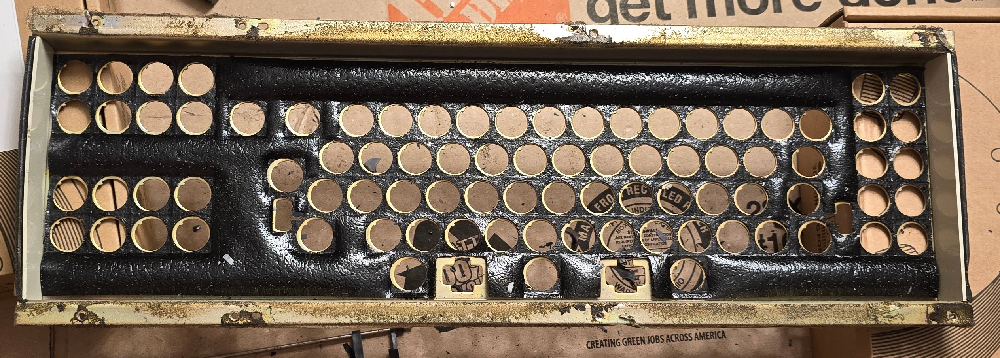

I also removed a hand-written sticker that was on the switch plate.  I don't know what it means, but I've seen it in photos of other
DisplayWriters, so I believe it was added during manufacturing.  I intended to preserve this label so carefully worked it off with
a plastic razor blade.  There was enough remaining original adhesive to affix it to a sheet of plain paper.

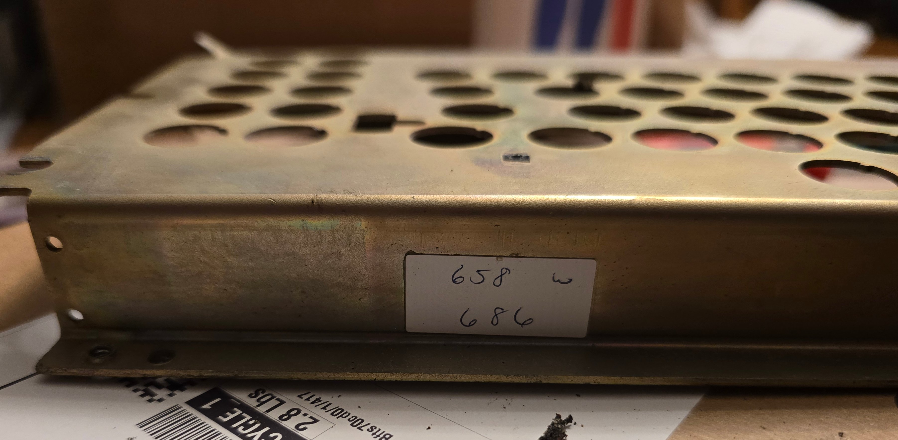

