# DisplayWriter Restoration: Restoring the Switches

Next up was the daunting task of restoring each individual switch.  This was a lot of work.  I ended up doing this
in parallel with some of the other cleaning work; but the exact order doesn't matter.

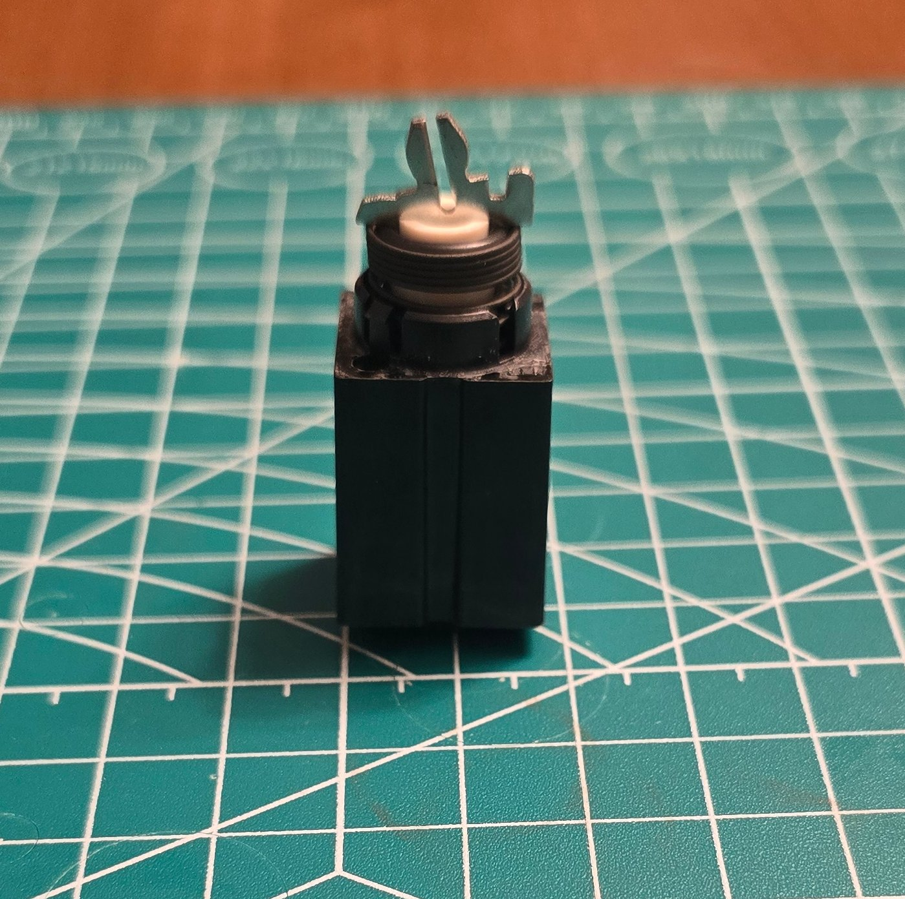

## Tracking Switches

In an effort to optimize the result as best I could, I decided to track each switch independently and keep all the
internal components correlated.  This takes more time and effort, but I had a few reasons for it:

- Since some switches on this keyboard suffered a significant impact, but others were unaffected (just very dirty),
  I wanted to keep track of which switches were subject to damage to potentially inform their placement.
- It's possible that some of the switches could exhibit wear-in behavior as that switch's components rubbed together
  while used over time, and this wear-in could be specific to a switch.
- I wanted to specifically track which switches required more involved repairs that might reduce their longevity,
  again to inform placement during reassembly.

I also wanted to catalog each switch's behavior fairly extensively.  This is partially to inform placement, but also
as a process control to ensure my methodology wasn't introducing systematic defects during the restoration process.

I tracked each one in a spreadsheet
that started with the columns:

- Switch ID (an invented identifier)
- Original position row
- Original position number
- Originally assigned keycap legend
- Current switch status
- Whether the switch clicked on arrival
- Notes on externally visible condition on arrival
- Actuation point pre-restoration
- Bottom-out point pre-restoration
- Reset point pre-restoration

The 3 actuation distances were measured using a Mitutoyo height gauge on a flat desk.  (Probably should have used a
surface plate, but mine is currently buried, and a straight edge says the desk was flat enough for this purpose.)
I don't have a gauge capable of measuring actuation force; otherwise I would have documented that as well.  Though
it's probably just as well I didn't have an excuse to spend even more time on this.  The height gauge was zeroed at
the top of travel, then advanced until actuation, then advanced again until it began to bottom out, then retracted until
reset.  Some of the switches produced a "double reset" (two reset clicks) if released very slowly; in these cases,
the latter (usually much louder) reset point was recorded.

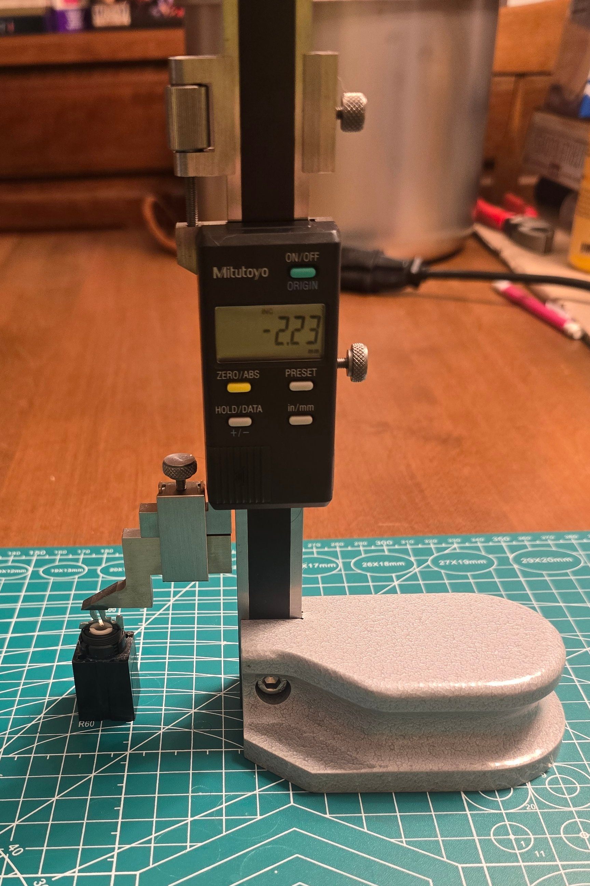

After initial testing, I added some additional columns to record the restoration process for each switch:

- General notes during switch disassembly
- Metal stem condition
- O-ring condition
- Return spring condition
- Switch housing condition
- Slider (+beam spring) condition
- Fly plate (+fly spring) condition
- Log of repair actions taken

I processed the switches in batches of 9, usually working on 2 batches in parallel while waiting for idle parts of the other batch.
Why 9?  Mostly just because one of my original fixtures was a 3x3 grid; but it was also a decent batch size for handling given
the amount of time spent on each switch.

## Disassembling a Switch

A beam spring switch is held together by the metal stem press-fit into the white plastic slider.  The metal stem needs
to be removed to access the rest of the switch.

The conventional method for removing these stems appears to be to grab the stem with pliers and yank it out.  This seems quick and
easy, but also prone to damaging the switches.  Indeed, other restoration reports typically describe breaking a few switches
during disassembly.  For irreplaceable vintage switches - especially on a board like this with so many already-damaged switches -
I didn't find this acceptable.

The problems with the "yank it out with pliers" method are:

- It transmits the substantial force through the fragile legs of the slider which are prone to breaking.
- It often requires using a penetrating lubricant in contact with several different unknown vintage plastics, risking unknown degradation.
- By hand, it's difficult to pull consistently in the right direction, potentially applying lateral force that can crack the slider.
- Pliers score up the metal stem.  It's possible (not confirmed) that these are galvanized for corrosion protection, so it's undesirable to bite through that covering.
- Yanking the stem out by hand is uncontrolled, and when it gives way, it's easy to let fragile parts go flying everywhere.

Instead, I developed a 3d printed stem extraction fixture.  It includes a printed plastic clamp to grip the contours of the stem
without damaging it, a slotted plate to brace the force against the main barrel of the slider instead of the legs, and a screw-jack
to apply the extraction force in a slow, controlled manner.

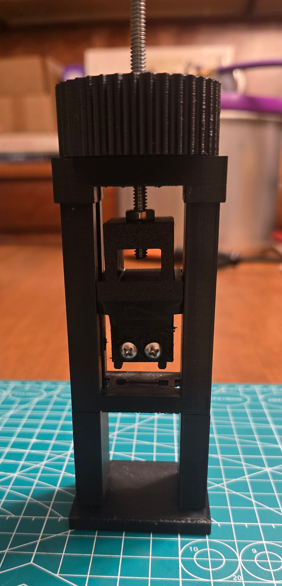

Using this fixture is definitely slower than just yanking the stem out with pliers; but it successfully handled every switch consistently
causing no additional damage.

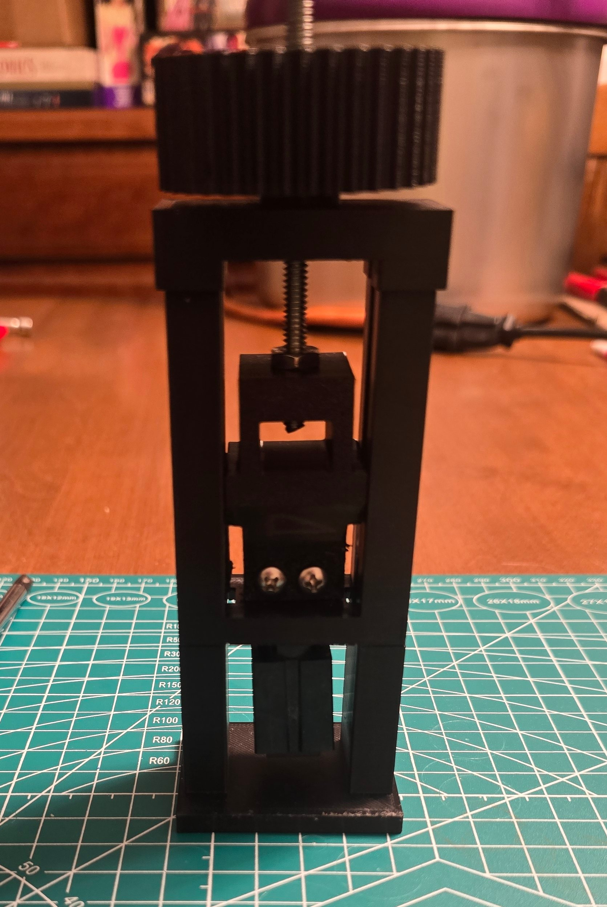

I did use the traditional "pliers method" for the first switch, since I needed to CAD up some part models for the fixtures.  This did
work, but required a fair amount of force and definitely scored up the metal stem.

After the stem is out, the return spring and o-ring can be plucked off the top, then the slider and fly plate fall out the bottom.  The fly
spring can be easily detached from the beam spring by carefully pulling one side off of the beam spring's tab.  Be careful not
to bend either spring too far outside of its normal range.

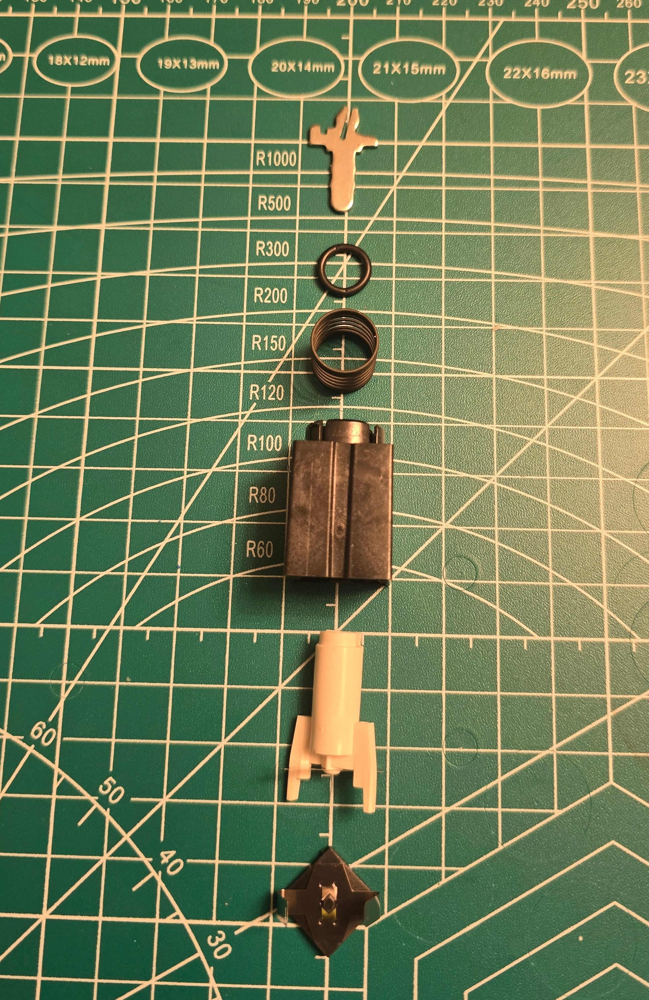

I laid out all the switches for the batch in order to keep track of the components, including any broken fragments.  (The photo below shows
3 broken switches in the batch.)

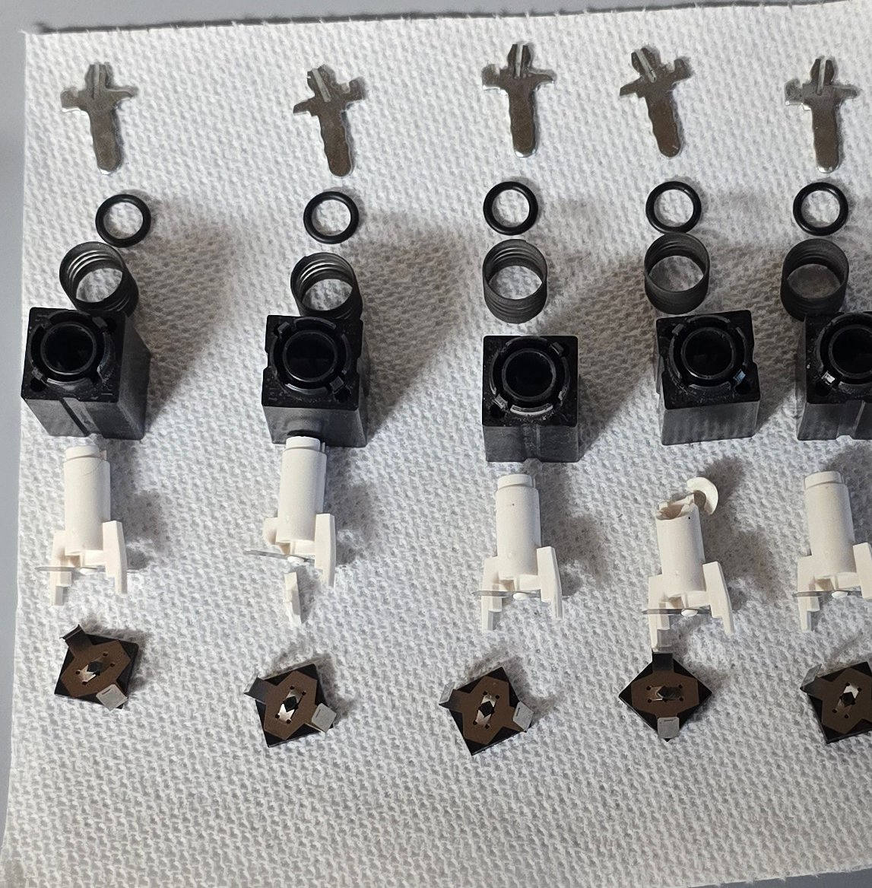

## Straightening Stems

Due to the damage to this board, a number of the metal stems were bent in various fun directions.  These switches also commonly had chips out
of the sides of the sliders from the force.

Some of the bent stems are obvious and can be easily identified, but some had more subtle bends.  These are easy to find by placing the stem
on a flat surface and pressing down near the edges of the stem to see if it sits flat or if it tilts.  (Make sure you flip the stem over and
check both sides for bends.)

Straightening the stems is relatively easy.  I'd recommend flat (non-serrated) parallel-jaw pliers; I specifically used a Knipex pliers wrench.

Most of the bends can be taken out just by firmly clamping the stem between the pliers jaws with some force.  I did this from a few different
angles and a few different directions since some of the bends were compound.  There was always a small amount of remaining springback in the
steel though.  I managed to take out the last bits of the bends by clamping them in the pliers just ahead of the bend then manually applying
force by hand in the opposite direction of the bend.  This usually took a few iterations to fully work out the bend.

## Fly Spring Gap Adjustment

While I had the switches apart (and in line with this project philosophy of going "all the way"), I decided to ensure that all the fly springs
were in spec to ensure consistent behavior across switches.  IBM specified a gap between fly spring legs of 1/2", but did not publish
tolerance figures on that.  For my purposes, I decided that plus or minus a few thou would be a good target.

I made a few 3d printed items to help quickly check the fly springs.  The simplest is a basic go/no-go stick; a half-cylinder with a diameter
of the high-end of the tolerance range on one side and a low-end of the tolerance range on the other side.  For an in-spec fly spring, the
stick's narrow end fits through the gap, but its wide end does not.

For fly springs outside of spec, IBM's instructions are to form them back into spec by hand.  This is a fiddly, iterative process; but it
does work.  The difficulty is that hand-forming the fly spring legs can introduce an asymmetry if only checking the gap spacing.  To help
with this, I made another 3d printed jig that the fly plate fits into and has lines for the proper symmetric positions of the legs.

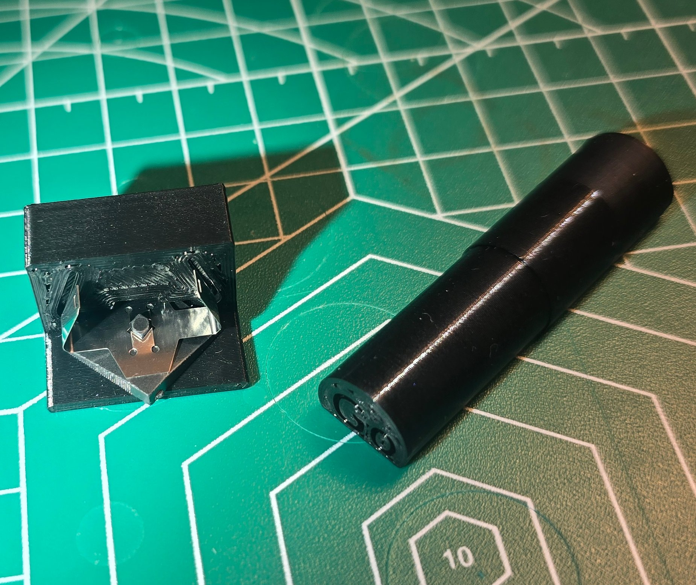

For each fly plate/spring, I first checked to see if it was already in spec.  Then if not, I iteratively gently adjusted the legs and checked
against the symmetry gauge.  Once close, I did a final check with the go/no-go stick.

In total, about half of the fly springs were in spec, and about half were out of spec by varying amounts, some significant.  Of the ones
out of spec, nearly all were too wide; only a couple were narrower than the spec.

## Cleaning Switch Components

I cleaned all switch components in an ultrasonic cleaner with just a mild dish soap solution.  The metal stems and return springs were cleaned
for 20 minutes at 40 degrees, and the other components were cleaned for 10 minutes at 33 degrees.  (I tried a few different settings throughout
the project to find the minimum necessary for complete cleaning.)  I left the fly spring attached to the fly
plate, and of course didn't attempt to detach the beam spring from the slider.

I've seen advice elsewhere to not clean the fly plates in an ultrasonic cleaner.  I'm not entirely sure why this is though.  There's nothing
about it that seems particularly vulnerable.  The fly spring is indeed a bit fragile, but nowhere near as fragile as the beam spring
attached to the slider.  I cleaned all of the fly plates+springs using this method with no evidence of any degradation.  (This doesn't mean
it's safe in every case - but in my case, it seems to have worked well with no damage.)

For intact parts (specifically excepting the broken sliders), I designed 3d printed racks to hold the components in a manner loose enough
to be effectively cleaned but retained sufficiently to prevent damage to fragile components.  This is especially important for the slider
with the fragile beam spring, and especially for the blow-drying process after (which otherwise can cause the beam spring to flail around wildly).

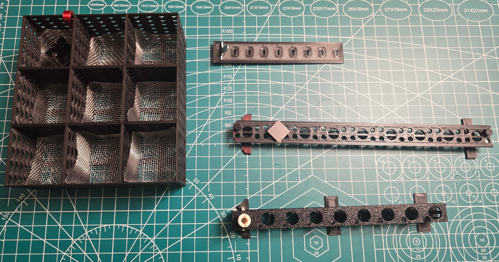

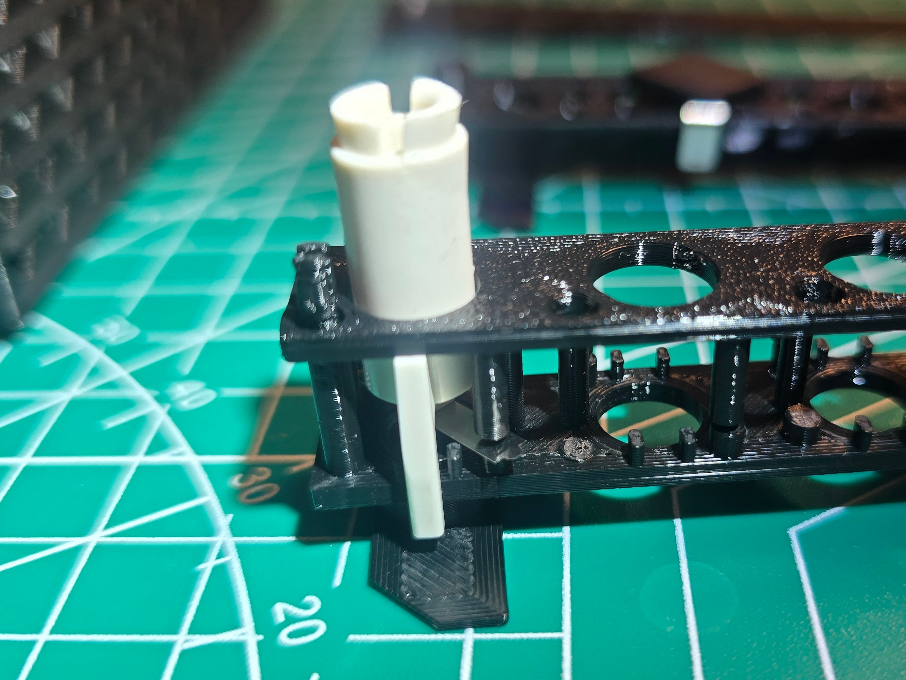

The rack for the sliders is in 2 parts.  The lower part loosely retains the slider and captures the beam spring.  The upper part slips
over the barrel and clips onto the lower part, capturing the beam spring from above.  The fly plate rack is simpler; just a shaped bar
that the fly springs slide onto, retained by the shape of the fly springs themselves, with pins at each end to prevent them from falling
off.  For switch housings and loose broken fragments, I used a simple 3d printed basket divided into 9 compartments with aluminum window
screen stuffed in.  The stem rack is a simple thin bar with slots that the stems snap into.  The return springs and o-rings didn't need
anything elaborate; I just put each on a loop of wire with a washer to indicate the leading position.

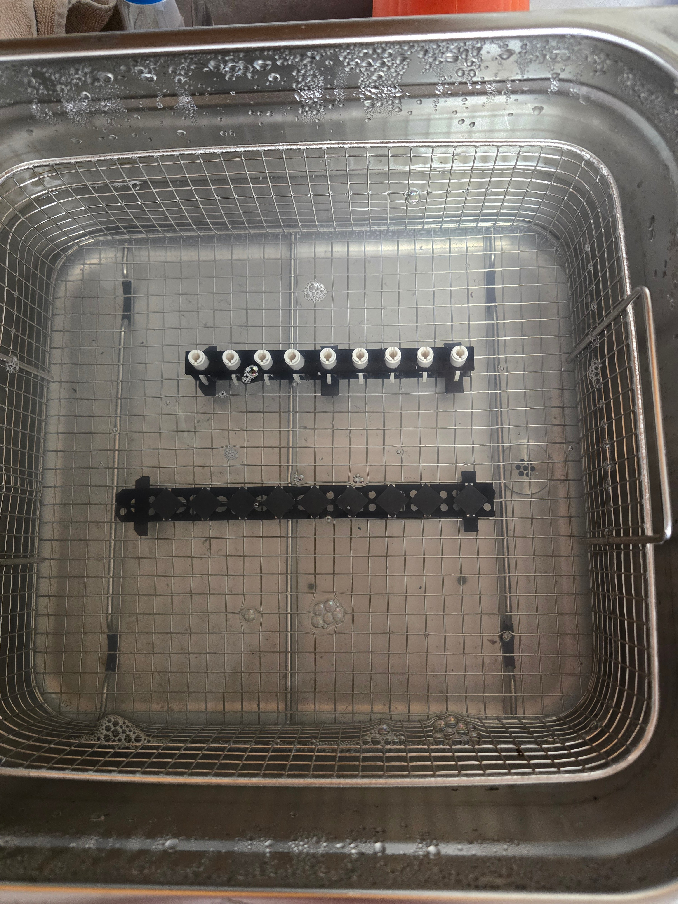

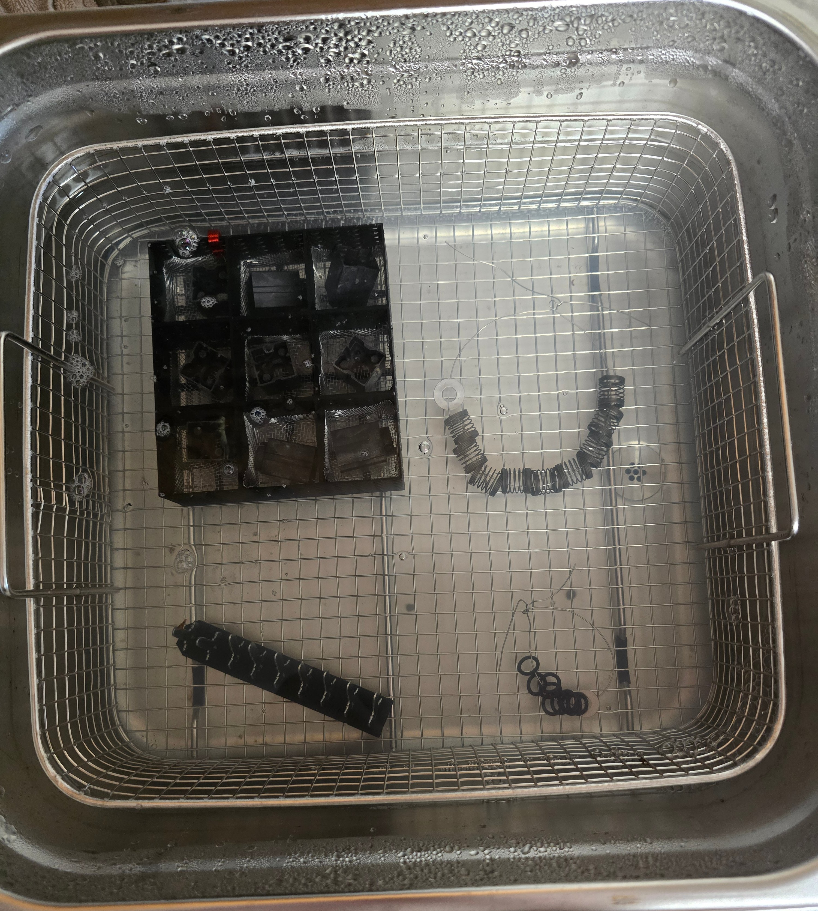

Coming out of the ultrasonic cleaner, each component got a rinse in ordinary tap water, then a dip in distilled water to dilute any salts
from the tap water.  Then components were blown dry using an electric air duster (DataVac brand).  The racks were especially important
for this; otherwise the parts have a tendency to fly around everywhere, and the beam spring can easily be blown outside of its
normal flexible range.  They were then allowed to sit for a while in case of any remaining water.

## Repairing Broken Sliders

Unfortunately, due to the fall this keyboard suffered, a number of sliders were cracked into pieces.  It was enough that I wasn't happy to just
replace all of them with scavenged spares and I wanted to try to repair them.

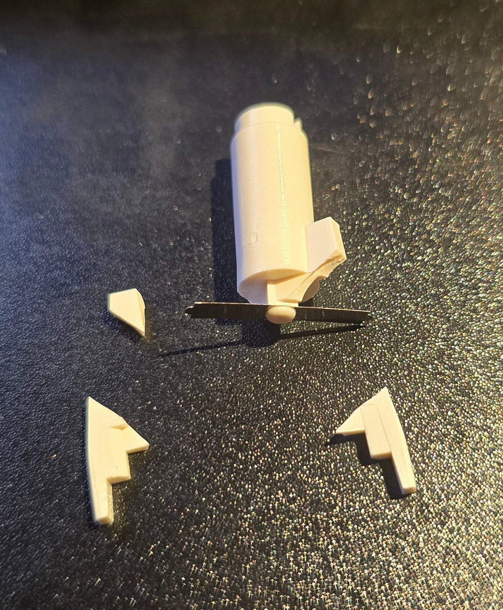

Considering how critical the geometry is for proper switch operation, I didn't think it would be a good idea to just try to
glue everything back together by hand.  Instead, I designed a 3d printed glue fixture.  It tightly fits all the contours
of the slider, has a clearance slot for the beam spring, and has wells around the most common fracture sites to prevent
glue sticking to the fixture.

All fragments were cleaned *before* being glued.  The joint surfaces additionally got wiped down with isopropyl alcohol.

For each broken slider, I'd assemble the pieces by snapping them into the fixture like a jigsaw puzzle, then applied liquid CA glue
to the cracks to wick into the joint.  Excess glue was quickly soaked up with a paper towel.  After allowing it to
cure (I highly recommend waiting the full cure time since just removing
the slider from the fixture can stress the joint), it can be popped out of the fixture.  I'd then apply glue to the reverse side
of the crack to wick in from the other side.

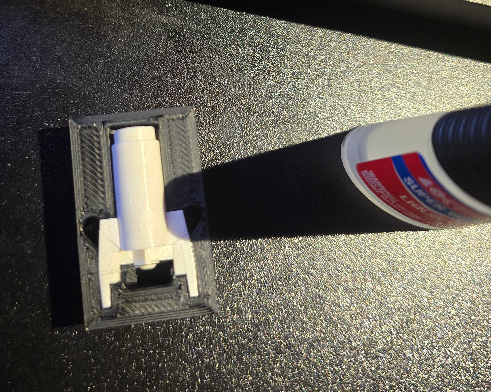

For cracks/joints that intersected with a bearing surface, I also very gently sanded down any glue on the surface to ensure it didn't
interfere, using a high-grit sanding sponges.  This was generally unnecessary for cracks on the slider legs, since the breakages
usually didn't occur on the bearing surfaces.  But another common failure was chips out of the slider barrel which is a bearing surface,
so those got sanded.

I can't speak to the long-term durability of these repairs; but so far, none have failed.  I played with several of the repaired
switches, intentionally applying a decent amount of lateral force (without going too over-the-top), and nothing has broken yet.

The repairs also seem to work quite well, usually with no noticeable difference in behavior.  A couple of the ones with cracks on
bearing surfaces do exhibit barely-noticeable resistance with off-center presses on that side.  This is one of the reasons I
tracked each switch independently so these switches can be placed in less-used 1U locations.

## Rust Prevention

Fortunately, none of the switch components had any rust on them.  And I want to keep it that way!

The fly spring and beam spring both seem to be made out of some type of stainless steel, and I didn't want to risk a coating interfering
with the classic switch feel or sound, so I left these uncoated.

The other metal switch parts - the return spring and stem - do not appear to be stainless.  I coated these with Starrett M1, a light plastic-safe
rust protectant, and allowed them to dry.

## Housing Lubrication

I waffled back and forth on whether or not to add any intentional lubrication to the mechanism.  It probably isn't necessary;
considering the large bearing surfaces, spring stabilization, and classic reputation for smoothness.  But in the end, I decided
I didn't want to compromise at all on smoothness, so decided to add a small amount of dry spray lubricant specifically to the
bearing surfaces of the housing.

A note about lubricants: Apparently, in recent years, several manufacturers have been reformulating their "dry" lubricants to be ...
not dry.  The first several brands I checked had all substituted their PTFE for mineral oil, and somehow still labeled it a "dry lubricant".
Not sure how they get away with that.  Anyway, I found that the Superlube-branded dry lubricant (Superlube Dri-Film) still uses actual PTFE, so went with that.

I wanted to be very sparing with the lubricant, and ensure it only made its way onto the bearing surfaces in the housing, to
avoid any unexpectedly migrating down to the pad card or other locations.  For this, I designed another 3d printed fixture.
It's a rack of "boxes" that the housings fit into and protect their outsides from spray as well as shaped inserts that snap
into the inside and mask off all areas except for the slider rails and cylindrical barrel - the two bearing surfaces.

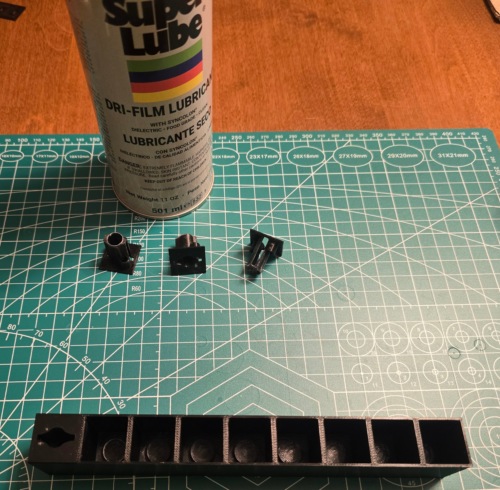

After putting all the housings into the fixture, I'd just go down the line and briefly spray into each one.

I don't know how much, if at all, this lubricant will help operation.  But I'm pretty sure it won't hurt.

## Swapping Components

In general, I tried to keep all of a given switch's components together; but there were a couple of cases where it made sense
to swap out parts.  Most notably, one of the switches had a fractured beam spring which could not be repaired, so that became
a donor switch for other faults.

One of the other switches had a badly damaged return spring, and a few others had severed o-rings, so those were swapped in from
the fatally damaged switch.  The couple other needed o-rings were ordered online.  All swaps are tracked in the spreadsheet.

## Reassembling Switches

After all the components were restored, they needed to be reassembled into a complete switch.

The traditional way to do this is the reverse of the disassembly process: Attach the fly spring to the beam spring, insert the
assembly into the switch housing from the bottom, place the return spring and o-ring on top, then press the stem into the slider.

This method makes me a bit nervous for a few reasons.

Unless substantial force is used, the stem doesn't get fully seated in the slider barrel.  Normally, the metal stem presses
against the o-ring which bottoms out against a ring on the housing, not the slider.  In normal switch operation, the slider
legs sit about a mm above the bottom surface (or pad card).  If press-fitting the stem using this method and stopping when
the stem bottoms out on the o-ring/housing, the slider is still positioned about a mm too low relative to the stem.  To fully
seat the stem, enough force has to be applied to compress the o-ring this extra distance, and then even more force to actually
seat the stem in the slider.

Additionally, using this method, all of the insertion force is transmitted through the fragile slider legs.  Other restoration
accounts note that insertion of the stem is easier than extraction (possibly in part due to incomplete insertion as described)
and I haven't found references to any breakage occurring at this stage.  Even so, this force wasn't something I was
comfortable with; especially with the number of repaired slider legs I was dealing with.

Inserting the stem by hand also makes it difficult to keep it straight since the top of the stem is slanted, but this may not
be a big deal if being careful.

Instead, I made another 3d printed fixture to keep the forces controlled.  A base inserts into the housing from the bottom and
has specifically-shaped stalks that bear on the base of the slider barrel, clearing the beam spring.  A separate piece contains
a socket to grip the metal stem and hold it at the correct angle so it can be pressed straight down into the slider barrel.

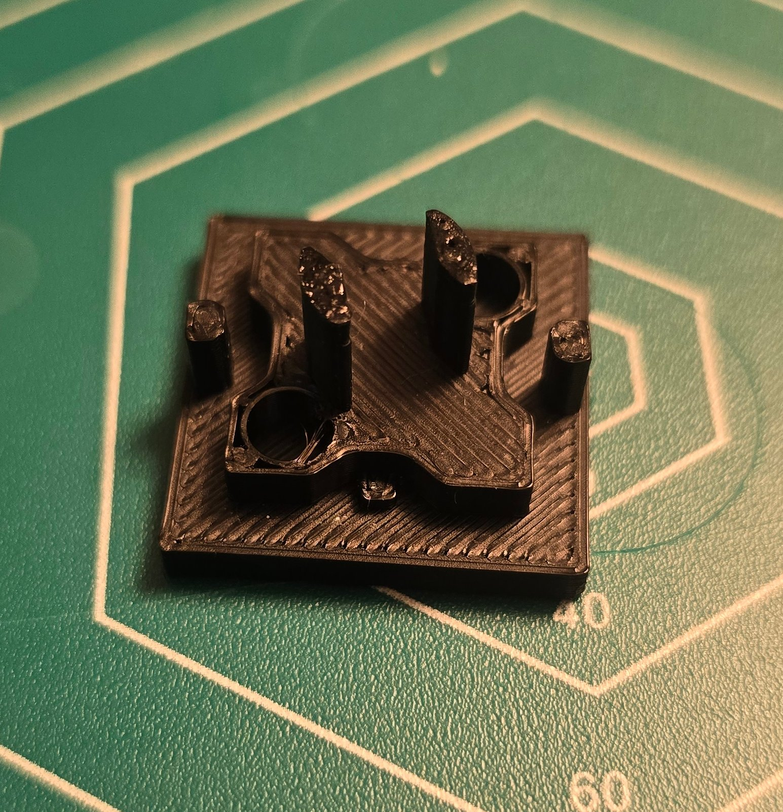

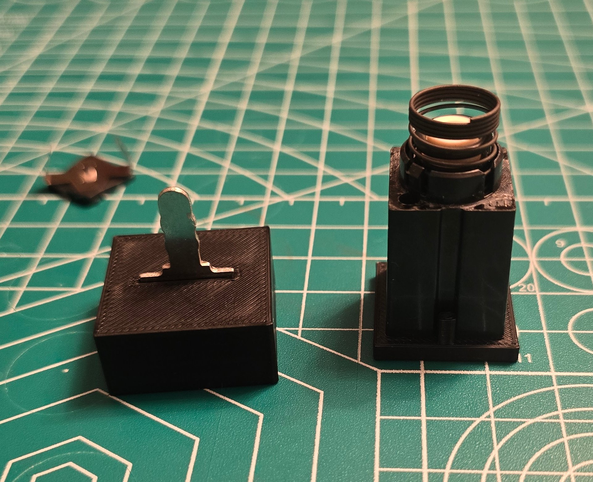

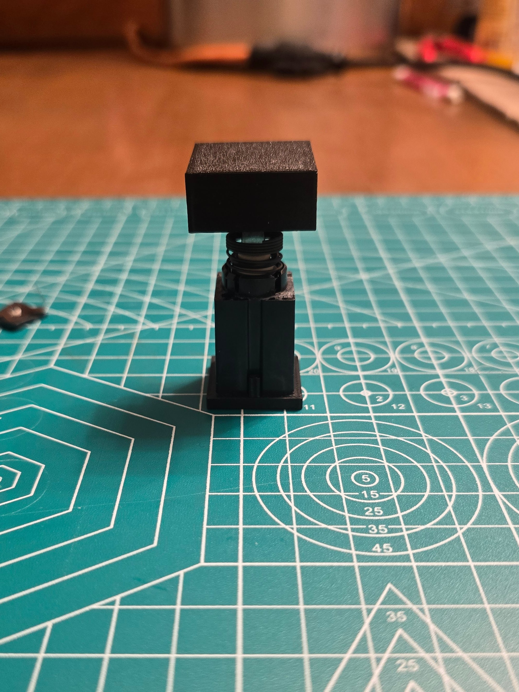

The problem with this is that it cannot work while the fly plate is attached, since it would be in the way of the fixture base,
so I had to assemble the fly plate/spring after the rest of the switch was together.

There's a classic method I read about for doing this - the "toothpick method".  The switch housing has 2 holes on the top designed
specifically for this purpose: A toothpick or wire can be inserted through each hole and used to bend the beam spring enough to
attach it to the fly spring.

I initially tried this method, and was successful a few times; but it's extremely fiddly.  You have to juggle the toothpick in
2 or 3 axes while simultaneously holding the switch in its actuated position and carefully trying to hook the fly spring onto
the beam spring's tiny tab.  It's doable, but it's slow; and I suspect it risks asymmetrically bending or damaging the beam
spring while fiddling with it.

Sounds like a job for another 3d printed jig!  This jig holds the switch upside-down.  It has a socket in the base for the
metal stem to hold it securely, clips that align to the switch's external rails and clamp over the base to hold it in the
actuated position, and specially-shaped prongs that insert into the maintenance holes and push both sides of the beam
spring symmetrically into the proper position for reconnection.

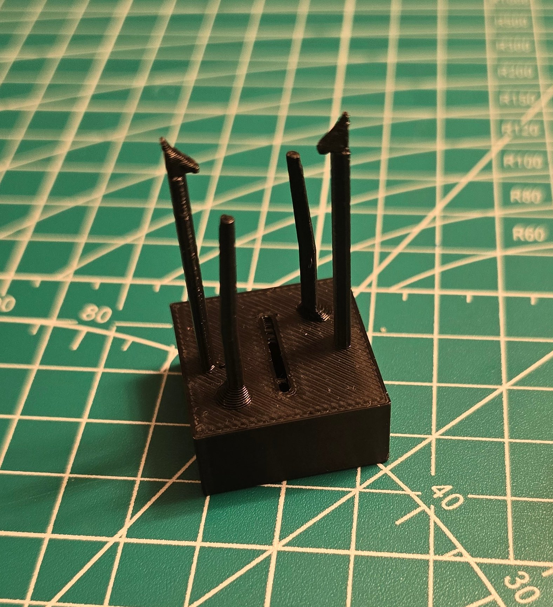

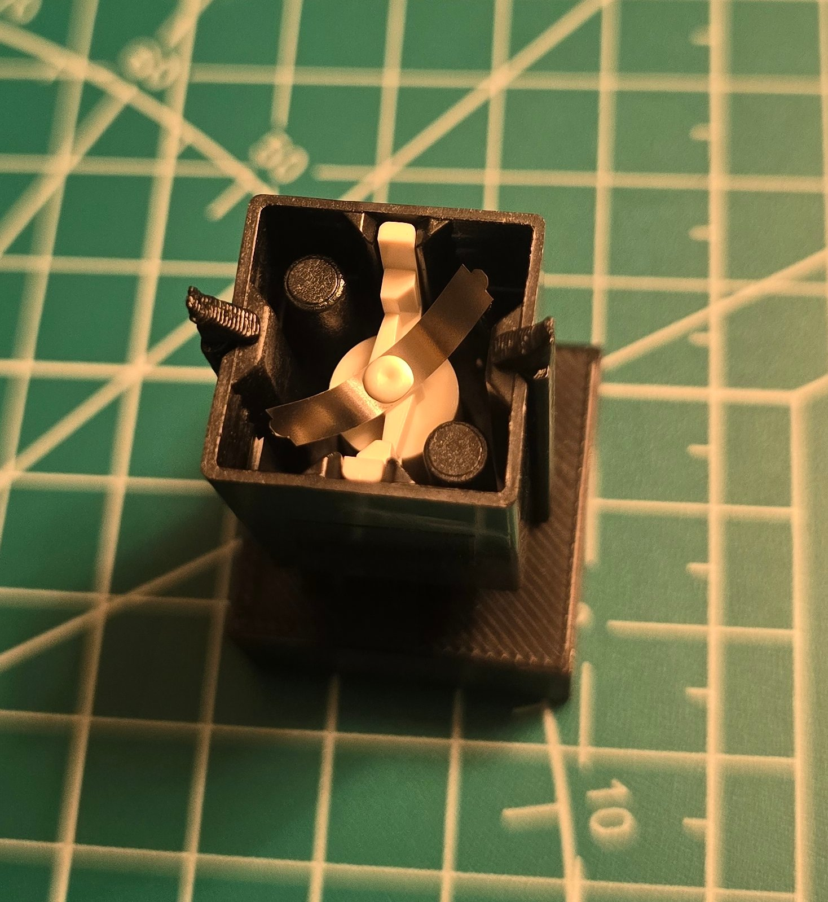

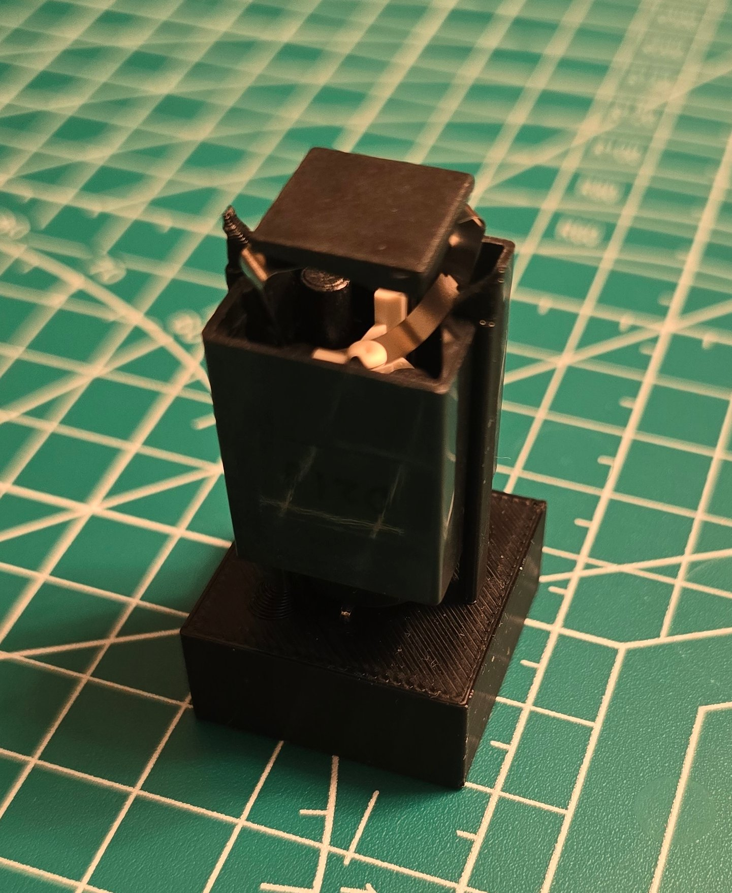

My full process for reassembly was:

1. Insert slider into housing.
2. Place housing on stem assembly jig.
3. Place return spring and o-ring on the housing/slider.
4. Insert stem into other part of stem assembly jig.
5. Press-fit stem into slider.
6. Remove switch from stem assembly jig and place into the fly plate assembly jig, latching it down and guiding the prongs into the holes.
7. Carefully hook fly spring onto beam springs ends, taking care not to bend the beam spring beyond its elastic range.
8. Unclip the switch and remove from jig.

Note: It's tempting to play with the switches once assembled; but only actuate the switch when it's on a clean, flat surface;
and allow the switch to reset while still on the surface.  If a switch is allowed to reset without something beneath it, it
has a tendency to launch the fly plate out the back.

## Switch Labels

Throughout the restoration process, I tracked switches and components by carefully keeping them in a consistent order.  After restoring them,
I decided to label each switch with the ID number I assigned; that way I can continue to track them easily if I swap them around more, and
don't need to be so careful to maintain the order.

These labels wouldn't survive the cleaning process, so I only attached them after finishing the switch restoration.

For these labels, I had three main criteria:

- Some kind of material that won't deteriorate over the long haul.
- Something very thin to not risk interfering with the clearances between switches in the assembly.
- Something that could potentially be removed without too much trouble in the future.

I ended up settling on polyimide/kapton tape.  Fine-tip sharpie was sufficient to write on it, but it did take a minute to dry.

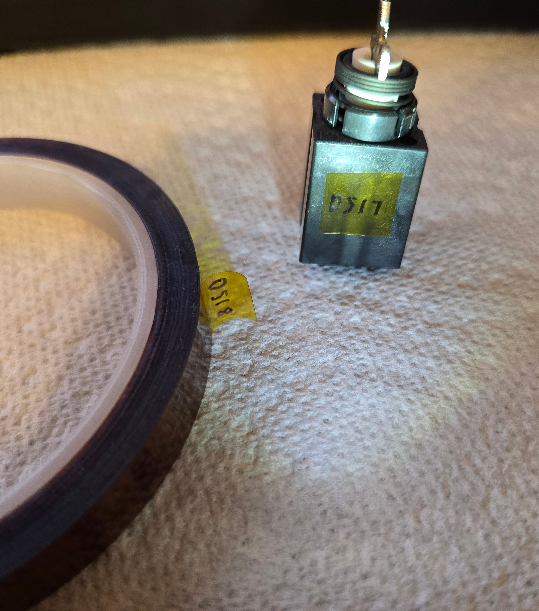

## Post-Restoration Testing and Rating

After reassembly of the restored switch, it was time to re-test the switch and feed the hungry spreadsheet.

I measured each of the actuation distances again using the same method.  I also added a few other columns for subjective rankings of
various switch properties.  Each of these got a letter grade from A-F:

- Repair Condition - Ranked A if no significant or glue repairs were necessary.  Otherwise ranked based on my best guess of effect on switch durability.
- Travel Behavior - Ranked based on how close the travel measurements were to the median, prioritizing consistency.
- Subjective Switch Feel
- Subjective Switch Sound
- Subjective Return Behavior - Some switches (I believe with slightly asymmetric bends in their beam springs) exhibit "double reset"
  clicks to varying extents.  This isn't a usability issue and isn't generally noticeable at normal typing speed, but I wanted to
  capture it regardless.
- Subjective Smoothness

I also gave each switch an "overall grade" combining all of the different aspects.  This wasn't just an "average" of the grades;
it prioritizes more important factors.  If all rankings were 'A' for a switch, it got an 'A+' overall grade.  Otherwise, it's
an approximate combination of the other grades, capped if the switch got a particularly low grade or was an outlier in any category.

These grades are used later when determining positions of the finished switches.  Better-grade switches are used for more-commonly-used
keys in my key mapping.  Additionally, all non-1U keys received switches ranked 'A' for smoothness, and key clusters
(such as arrow keys) received switches that clustered around similar travel behavior.

## Final Verdict on Restored Switch Quality

The results of this process exceeded expectations significantly; especially after reading so many reports of additional damage
during switch restoration, and after seeing the starting condition of this board.

When everything was complete, I was left with only a single non-functional switch - the switch with the fractured beam spring
that also became a donor for other parts.  That was far better than I had hoped, so I was quite pleased.

Additionally, there were more 'Very Good' switches than I expected.  Most of the significant damage was concentrated on switches
near the borders of the keyboard, presumably where it clattered around when dropped.  The alpha keys largely had undamaged and
well-performing switches - which was great, since these are some of the most-used keys.

There were still a few other sub-optimal switches for various reasons:

- The caps lock switch was intact and performed well.  However, it (intentionally) lacks a return spring.  Since I plan to remove
  the latching mechanism and use this as a Ctrl key, I needed a switch with an intact return spring.
- One of the switches had a chip in the slider barrel that had fully detached and was missing.  Interestingly, this doesn't
  actually affect switch operation.  The switch is such that it doesn't affect slider retention.  However, it likely will affect
  long-term stability.

## Acquired Replacement Switches

Before even receiving the keyboard, I knew from reading other reports that I'd likely need some number of replacement switches,
and would at least need a springed substitute for the caps lock switch.  I also knew these could be rather difficult to find.

Fortunately, I came across an ebay listing that had a handful of individual switches available for purchase.  I purchased a couple
of these before receiving the keyboard.

After the keyboard arrived and I saw the extent of the damage, I became much more worried that I'd need to replace a large number
of switches.  And because these are hard to find, I decided to jump on a few more switches from the same ebay lot.  I ended up
with a total of 10 spare switches.

In the end, the switch repair was more successful than I expected, so I technically didn't need all the replacement switches.
They could easily replace the broken switch and springless caps lock switch.  I ended up measuring and grading them on the same
scale as the others and swapped most of them in to replace lower-graded switches.

I do have one complaint about these spares though.  The seller listed them as "ultrasonically cleaned", and they did indeed look
pretty clean; but there was an issue.  I disassembled all of these switches and re-cleaned them using the same process as all
the other switches, and every single one of them had isolated light rust spots in exactly the same place - the base of the return
spring.

I figured what likely happened is that the seller ultrasonically cleaned the switches as a unit without disassembling, then
let them sit out to air dry upright.  Unfortunately, the return spring sits inside a narrow circular cavity in the housing that
traps water in this position; so I bet this is the source of the rust.

So a warning to others working with these switches: Ideally, don't ultrasonically clean them while assembled; and if you do,
make absolutely sure you pull all of the water out of that cavity.

In the end, I ended up just accepting the rust.  It's very light, isolated, surface-level, and doesn't appear progressive.  I
did apply a few extra coats of Starrett M1 to those springs though.

