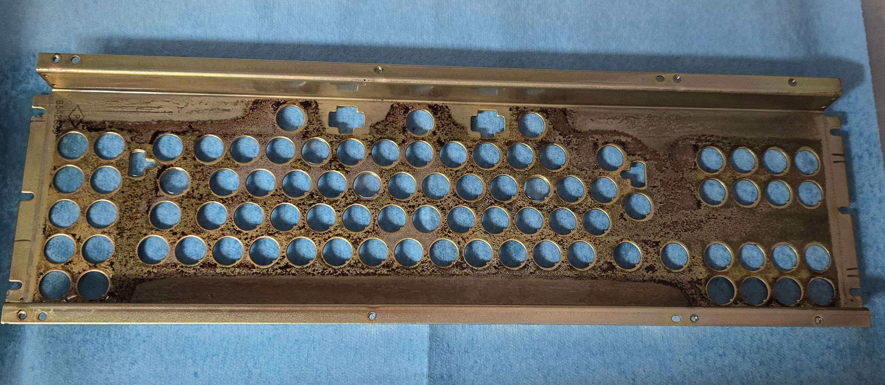
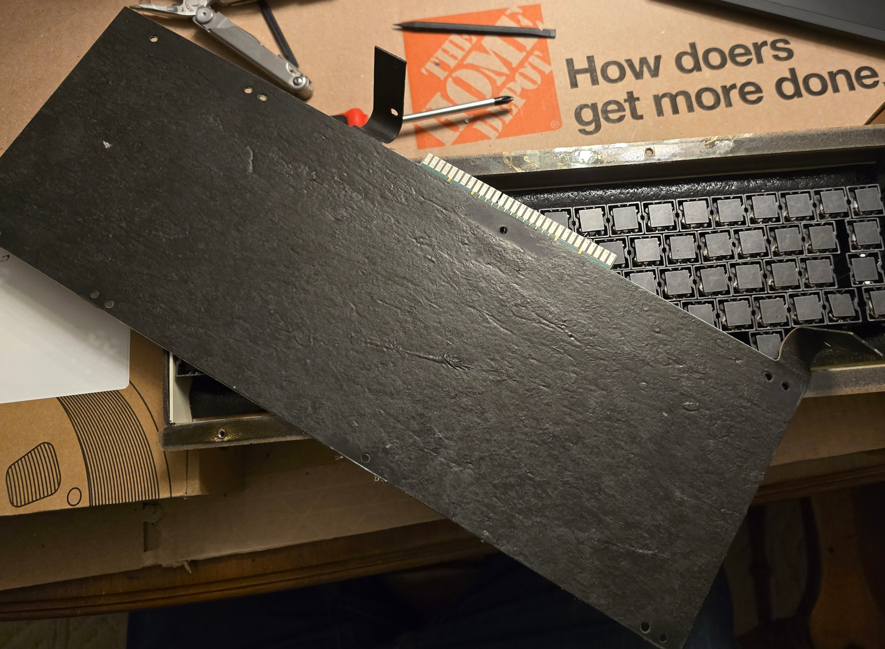
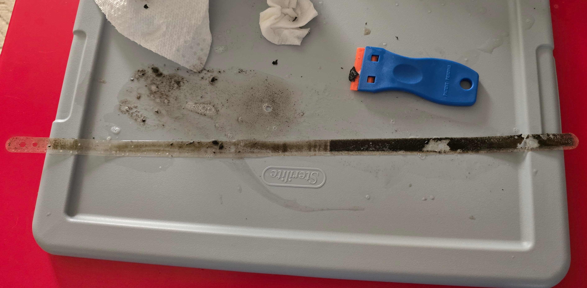
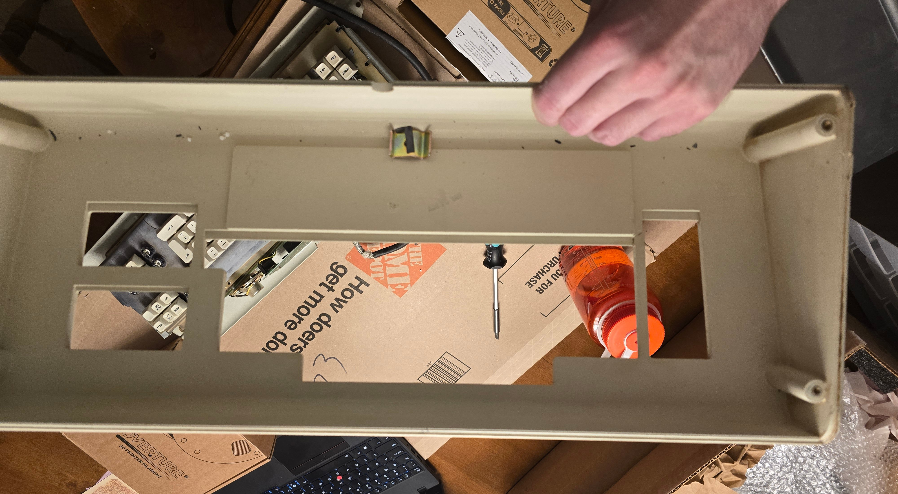
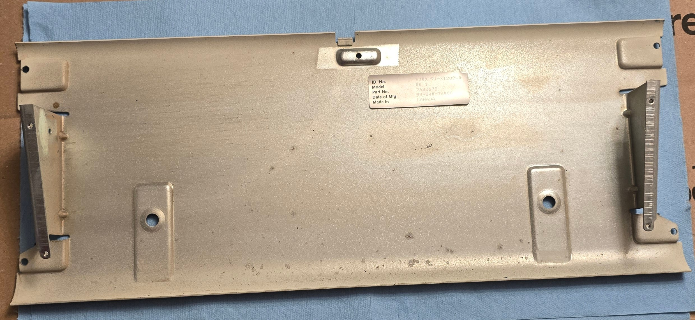
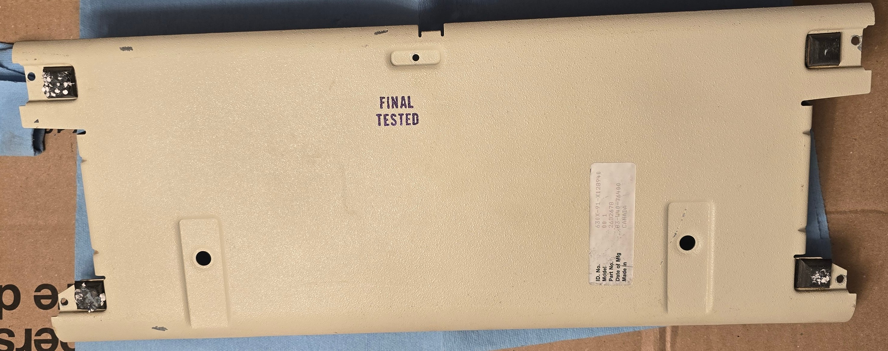
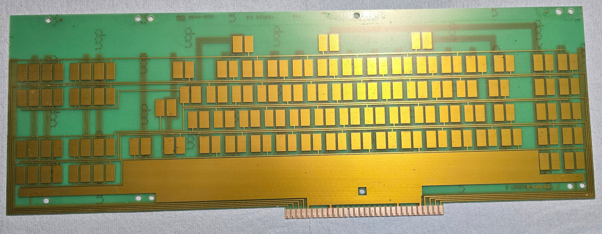

# DisplayWriter Restoration: Cleaning the Components

As would be expected, the keyboard was pretty filthy.  Not the worst I've seen in other restoration reports, but also far
from the best.

My priority when cleaning everything was being safe and ensuring I didn't cause any unexpected damage.  I used a few
different methods, but in general, I leaned heavily toward mild methods unless they proved insufficient.

## Cleaning the Switch Plate

This was the most involved piece to clean, since it included the deteriorated foam.

At first, the foam visually didn't look too bad; but it was a mess.  It had basically turned into a sticky, tarry soup
that only resembled its original shape.  There was no way it could be preserved.

There was also deteriorated foam and adhesive residue on the edges where the plastic gasket strips were located.  This
may be a different type of foam, though, since it was easier to remove.

My first attempt to remove everything involved spraying with isopropyl alcohol (99.9%) and scraping with a plastic
razor blade.  This alone appear to be sufficient for the adhesive and remaining foam under the gasket strips.
It also removed the significant majority of the bulk of the switch foam, leaving only sticky residue and isolated rough spots.

After that stopped making progress, I had to consider more aggressive methods.  My main concern here was the coating on
the metal plate.  This kind of plate typically has a microscopically thin chromate coating on top of a galvanized zinc
layer (this is typical, but not specifically confirmed in this instance).  Based on the preserved color of the plate, the chromate coating is still largely intact, and I wanted to keep it
that way.  This immediately eliminates any abrasive cleaning methods and most scraping with metal blades; and certain
solvents are potentially risky.

I ended up trying two more methods - mineral spirits and goo gone - each time allowing it to soak for hours in a sealed
container then scrubbing and scraping with a plastic razor blade.

Neither of these methods made appreciably more progress than just the alcohol, despite extensive attempts.  Though they
did remove all remaining tackiness.

What remained at this point was a metal plate that was pretty clean overall, but still had detectable and visible rough
spots where the foam was previously compressed.  The roughness was very shallow, less then a tenth of a mm, and was no
longer tacky at all.

There also appears to be a plastic film underneath where the foam was, possible an original backing material for the
foam.  This foam is adhered extremely well to the underlying metal.  None of the solvents I tried touched it at all.
I also attempted to lift the corners by carefully using a metal razor blade; but made zero progress.  I want to get
me some of whatever adhesive they used for that!  Further attempts to remove the film would likely be damaging, and
it's not hurting anything, so the film stays.

At this point, the plate is clean enough to proceed.  The remaining roughness will have no effect on the installation
of replacement foam or its operation, so I called it.

## Cleaning the Rubber Mat

The "rubber mat" backing the pad card was actually in pretty great condition for its age, just a very small amount
of surface tackiness.

I also have no idea what material this actually is.  It has properties that resemble rubber, but based on its texture
and the cut edges, it appears to be quite fibrous.

Without knowing more about it, I wanted to be extremely conservative with cleaning - so it's good it was already in
great condition.

It just got a wipe-down with mildly soapy water followed by a clean water rinse and pat dry.  This cleaned it right up
and removed all of the surface tackiness - ready to reinstall.

I neglected to take a pic of it post-cleaning, but it didn't look much different.

## Cleaning the Plastic Gasket Strips

The plastic gasket strips removed from the switch plate need to be cleaned before they can be reused - they were full of
deteriorated foam goo and old adhesive residue.  Once clean, these strips are transparent.

When cleaning these, care needs to be taken to not bend or kink the strips.  Always hold the strip from one end and clean
it by pulling in the opposite direction to keep the strip under tension.

I put down a flat plastic surface, laid out the strip (goopy side up), soaked it in soapy water, then repeatedly scraped
it with a plastic razor blade.  This removed the bulk of the deteriorated foam goop.  I then did the same thing but with
isopropyl alcohol, and this cleaned up almost all of the rest of the foam, returning it to mostly-transparent.

One side of the plastic strip was still quite sticky; the adhesive was really holding on.  This wasn't an issue though,
since this side is just getting reattached to new foam anyway.

## Cleaning Plastic Switch Plate Side Pieces

These were in good condition - both the plastic parts and the rubber mat attached to them - so didn't need much work.
I just wiped them down with soapy water, rinsed, and dried; and they look good.

## Cleaning the Outer Case

The DisplayWriter outer case is made out of some kind of thick (~7mm) plastic of unknown variety.  My case was also
cracked, but that's a problem for later!

My case also includes an original DisplayWriter system information card which I wanted to preserve.  I first masked
off the info card with a piece of plastic transparency and masking tape.

Cleaning was very basic; mildly soapy water, scrubbing with a toothbrush, followed by a few plain water wipes.  This
was sufficient to remove all the visible staining.

I also drizzled some alcohol through the crack in the case to prepare it for glue.

## Cleaning the Switch Assembly Backplate

This metal plate is made of the same chromate/zinc coated steel as the switch plate.  It was already pretty clean,
just with some dirt on the outside and a bit of slightly tacky residue from the rubber mat on the inside.  It only required
a wipe down with isopropyl.

## Cleaning the Base Pan

The base pan/case bottom is made of painted steel.  The major issue with my base pan wasn't cleanliness, but rather
how warped and bent the brackets were from the fall.  In retrospect, I probably should have fixed that before cleaning;
but cleaning it first worked too.

This part contained 2 manufacturing labels - one on the inside and one on the outside.  Both were still adhered; the outside
label is adhered well, but the inside one is peeling at the edges.  I originally planned to remove and reattach the inner
label to correct this, but the parts still attached weren't giving up easily, so I decided to just leave it.

Like the other components, I cleaned the base pan with soapy water and a toothbrush, followed by a distilled water wipe-down,
being careful to avoid the labels.

The other aspect of the base pan to deal with was the rubber feet attached to the bottom.  These have definitely degraded
to an extent - they're very soft and sticky - but the bulk form of them is still intact.  There are also styrofoam pellets
embedded in the feet from how it was shipped.

I was on the fence about what to do with these.  On one hand, they're still functional, just extra-grippy, and would probably
work fine if used in a mostly-stationary manner; and keeping them is more in-line with the historical preservation
objective of this restoration.  However, I'd also really prefer not to get any of the sticky residue on my desk; and I'd
actually prefer it to be *less* grippy so I can slide it around the desk more easily - it's not like this behemoth is
going anywhere regardless.

In the end, I ended up keeping them, but encapsulating them with ordinary scotch tape.  This retains the material and
cushioning but will prevent any residue transfer.

I did attempt to pick out the embedded styrofoam pellets and other debris with tweezers.  I was able to remove about half
of it before getting to the point that removal would require destructive digging.

Most of the paint on the base pan was intact; but there were several spots where paint was chipped, and the inside showed
a few isolated corrosion spots.  The corrosion spots were mostly isolated and appear to be a more stable form of dark corrosion, so a full
rust removal treatment likely isn't necessary.  I did coat any bare or corrosion spots with Starrett M1.

## Cleaning the Pad Card

I was relieved to see that the pad card was in good condition!  A bit dirty, as expected, but not too bad.  All it really
required was some swipes with 99.9% isopropyl alcohol.  The card edge contacts were even still shiny copper so I didn't
need to do anything here.

## Cleaning the Keycaps

The main legends on the keycaps are double-shot, but the front legends are pad-printed.  These pad-printed legends should
be plenty durable for normal use (where the fronts of the keys aren't touched); but they could potentially wear down during
cleaning.  Because of this, I decided not to use the ultrasonic cleaner here.  I probably could have used it for keycaps
without front legends, but I ended up just treating all of them the same to ensure consistency.

The keycaps were soaked in soapy water for a while, then scrubbed with a toothbrush, then rinsed in tap water and soaked
in distilled water.  It's important to ensure the keycaps are fully dry - especially the narrow stem socket - before
putting them on the metal stems.  I used an electric duster to blow-dry them (which also helps get any remaining bits
of contamination shield out that might be stuck in the socket) then let them sit for a couple days.

The space bar has molded-in metal inserts for the stabilizer.  The only way I treated these any differently was to coat
them in Starrett M1.

## Miscellaneous Other Hardware

There are a number of other bits and bobs that are part of the assembly - various screws, clips, plastic inserts, etc.
These all went into the ultrasonic cleaner.  Metal components got a longer higher-temperature run followed by a coating
of M1; plastic components got a shorter lower-temperature run.

The exception is the speaker.  I pretty much just left that alone except for a gentle dusting.

