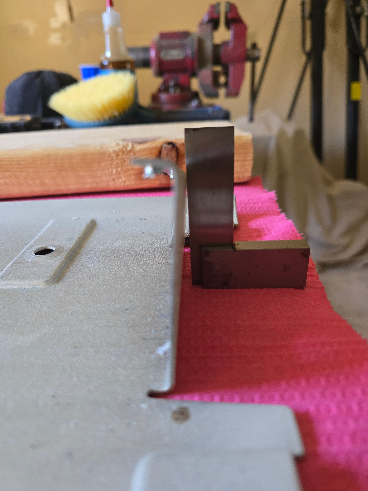
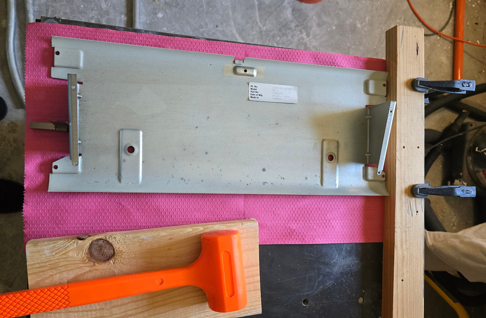
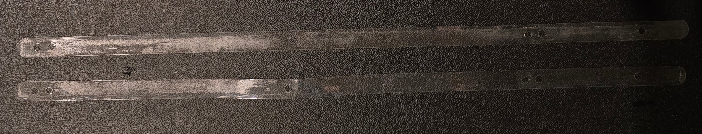
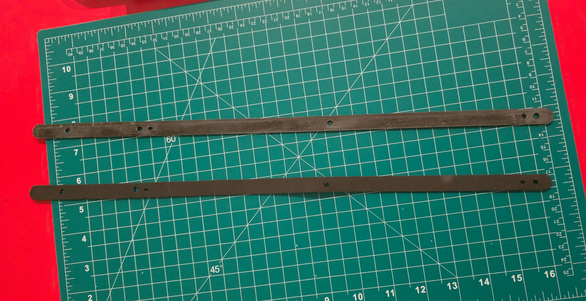
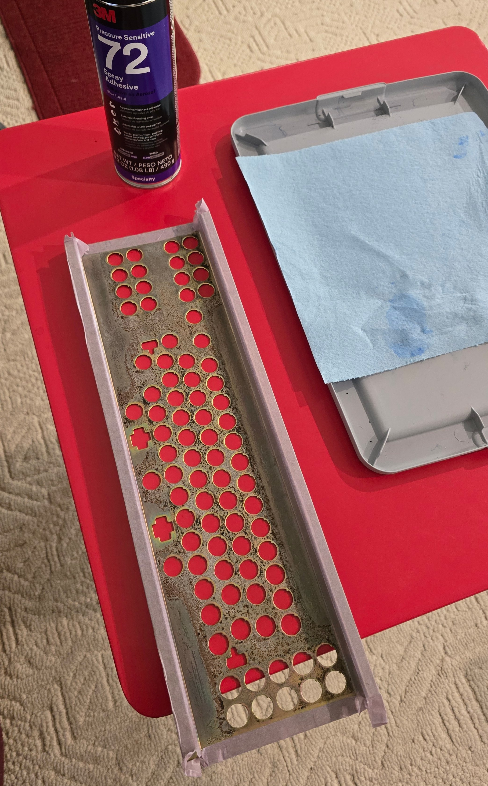
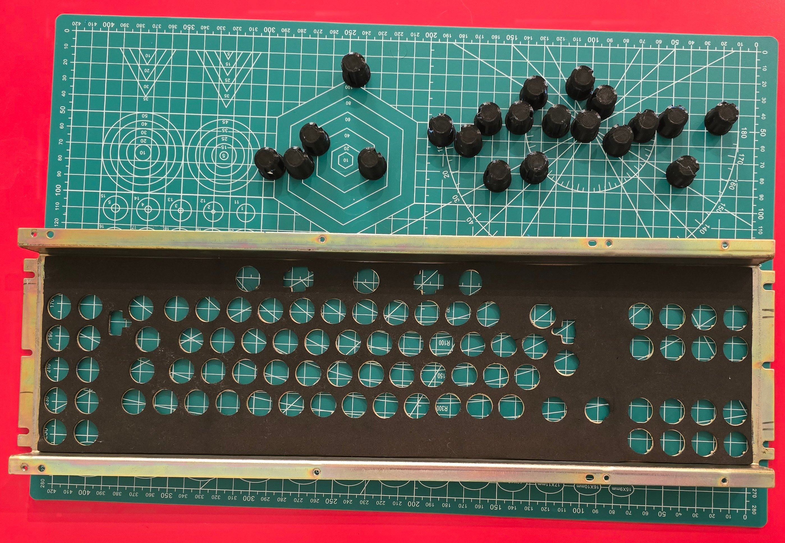
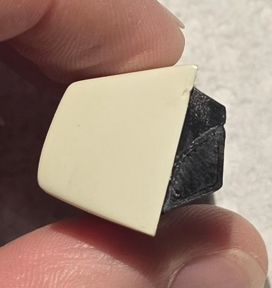
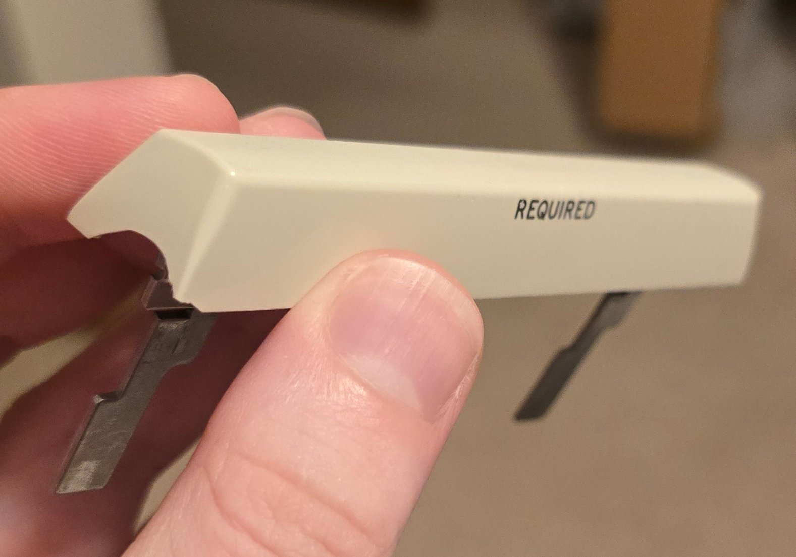

# DisplayWriter Restoration: Restoring Other Parts

Restoring the individual switches takes the bulk of the time and effort, but some other components need some other
restoration steps prior to reassembly.

## Repairing Bent Base Pan

As described earlier, it appears that the keyboard suffered a significant drop at some point.  When it hit the ground,
the inertia of the heavy internal switch assembly significantly bent and warped the base pan brackets.

Both brackets were bent in the same direction, one (the "bottom" one when it fell) much more than the other.

I initially tried bending them back by hand, but was unable to apply sufficient force.  What worked was carefully
and incrementally using a plastic dead-blow hammer with the other side braced against a block of wood.

After each set of taps, the bracket was checked with a machinist square at 3 different places (it's easy to twist
it otherwise).  Then after both were square, the geometry was verified by checking the distance between the screw
holes against the tabs on the switch plate.

The flanges on the switch plate were also bent up.  These were easily fixed with a bit of work with smooth-jaw
parallel pliers.

## Gasket Strip Foam

Earlier, the plastic gasket strips were cleaned and the old foam removed.

New strips of foam have to be reattached before reassembly, as this foam provides compliance to take up any deviation
between the parts of the switch frame.

I used 1/16" EPDM foam, ordered from McMaster Carr, #8647K102.  This seems to be a close fit to the original material.

The foam needs to be cut into strips matching the shape of the plastic strips, then adhered to those plastic strips.
The adhesion between these components isn't critical, or even really necessary - when the assembly is together, they're
held together with screw pressure regardless.  So any adhesion here is really just an assembly aid.

In my case, I was able to clean off essentially all of the old foam from the plastic strips, but some adhesive residue
remained.  I just used this existing adhesive residue to lightly adhere to plastic strips to the foam; this worked well.

I adhered the plastic strips to the foam sheet first, then carefully cut around the plastic strip with a scalpel.  This
results in a very good foam fit, but you need to be very careful not to damage the original plastic strip.

To punch out the screw holes, I used a drill bit just held between fingers, rotated in reverse to avoid damaging the
plastic strips.  The resulting holes in the foam weren't perfect, but I was able to clean them up decently with
tweezers.

## Switch Plate Foam

This foam is also critical to replace, since it provides the preload and compliance for the switches themselves.
Originally I was prepared to trace and cut the replacement foam from the same sheet used for the gasket strips,
but I ran across an ebay listing for pre-cut DisplayWriter foam, so decided to order that and save a bit of effort.

The two challenges here are: Which adhesive to use, and properly aligning the foam.

Like the gasket strip adhesive, the adhesive used for the switch foam isn't critical to operation, since the switches
and foam are held in with screw pressure once assembled.  But it's very helpful to have to foam affixed in position,
so I recommend adhering it somehow.

I used 3M #72 spray-on adhesive for this.  I chose this because it's designed to bond to flexible, compliant surfaces
like foam, because it has a long open-time to allow getting the alignment right, and because it's a repositionable
pressure-sensitive adhesive allowing for adjustment.  (Don't rely on this latter property though - with such soft
foam, even light adhesion is more likely to tear the foam than separate from the adhesive.)

Masking tape was used to mask off all parts of the switch board except where the foam will be adhered.  It's better
to mask off a little too much (since the adhesive here isn't actually critical) than too little (which will leave
exposed adhesive).

Then I sprayed a light layer of adhesive on.  This adhesive sprays out in ropey blue strings rather than an even
mist - this is part of why it adheres well to soft, compliant surfaces.

In retrospect, I probably should have also found a way to mask off the switch holes.  I expected the sprayed adhesive
to go straight through the hole; but it was ropey enough that a number of strings of adhesive ended up spanning the
holes.  It wasn't a big deal though, and I was able to easily remove these strings with tweezers later.

Getting the foam properly aligned to all the holes in the board is tricky.  As an aid, I 3d printed a couple dozen
alignment pins that fit through the holes from the front.  I then set the foam on top of the alignment pins and
carefully, section-by-section, pushed it down, ensuring it stayed aligned.

In one or two places where a mm or so of foam overlapped a hole, I used a knife to cut it back.

I'm happy with how it turned out.  The alignment isn't perfect (I probably should have just printed alignment pins
for every hole) - but looking at the 'before' pictures, this alignment is actually better than the factory original.

## Keycap Repair

Two of the keycaps with this keyboard were damaged: The 'CODE' key had one of its supporting "feet" mostly broken off,
and the space bar had a chip in the side.  In both cases, the missing chips/material was not present.

For the 'CODE' key foot, I repaired it by 3d printing a chip filler following the contours.  This involved photographing
a profile of the chip, tracing it out in CAD, and iteratively printing and adjusting until it fit the chip geometry
perfectly.  It still wasn't a close enough fit to use liquid CA, but gel CA worked well.

I took the same strategy for the space bar chip.

I got so far as ordering the closest color match PETG filament I could find (with plans to additionally paint it to get
it even closer), refining the model of the chip, and printing a few.  But when trialing fit, it started to look like a
repair might be more noticeable than the original chip; so I decided to leave it as-is.  Indeed, once assembled, the chip
is barely visible unless specifically looking for it.  I did print a few replacement chips in case I ever change my mind.

## Replacement Keycaps

This keyboard originally arrived with 8 missing keycaps, most of which were "special" keys with unique legends.  My original plan was to either:

- 3d print replacements.  I could probably get the geometry right here, but the texture and legend styling wouldn't be a good match, and a decent color match would rely on paint.
- Pick a few replacements from a Selectric keycap set, which periodically pop up on ebay.  This would probably be a better texture match, but wouldn't have the right legends and might not have the right geometry for the row.

In the end, I happened across a better solution.  Just by chance, another ebay listing appeared for a 'for-parts-condition' DisplayWriter keyboard.
This one appeared to be in even worse condition than the one I ended up with and was missing even more keycaps; but
luckily for me, it had all 8 of the keycaps I was missing.  I reached out to the seller, and they agreed to sell me just
the keycaps I needed for a steep $25 per keycap.  Ah, the joys of beam spring ownership ...

After cleaning, the replacement keycaps are indistinguishable from those that came with this board, so I lucked out!

## Repairing Case Crack

Repairing the case crack was pretty simple.  I flushed the zone out with isopropyl alcohol, let it dry, then
applied a small amount of liquid CA from the back and sides.

After holding the joint tightly together for a few minutes, I stuffed a towel in the gap to keep pressure on it
and let it cure over night.

The joint fit together perfectly.  The result is a clean joint that cannot be felt with a fingernail, but the
crack is still slightly visible.

