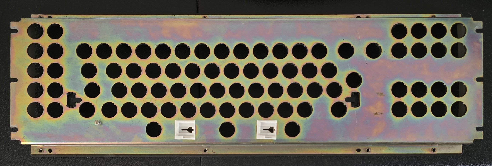
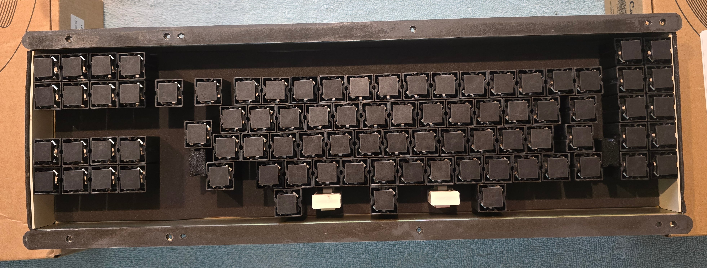
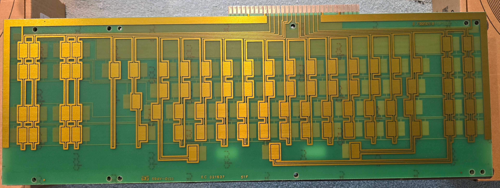
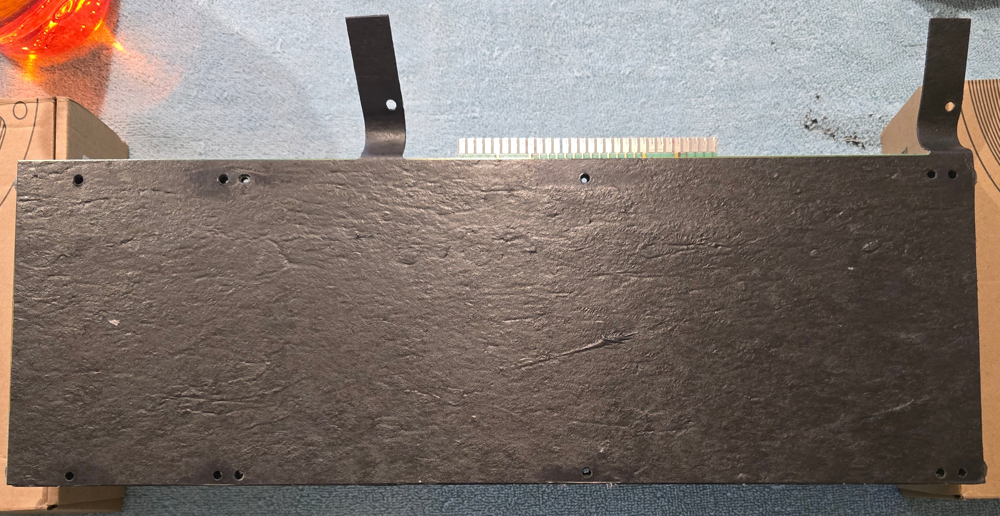
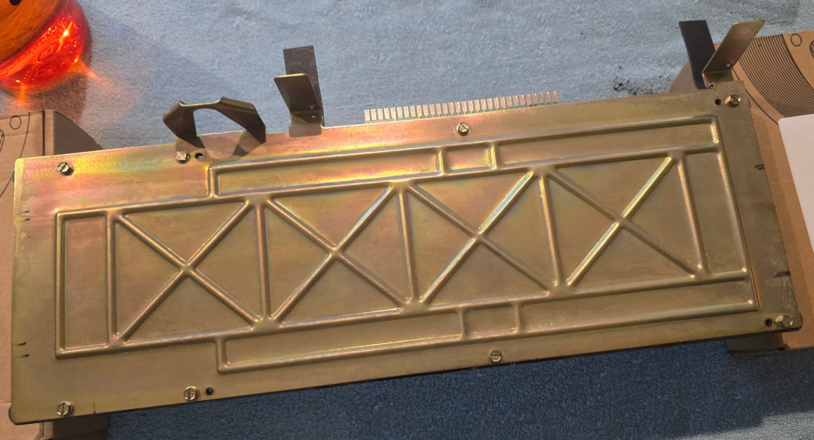

# DisplayWriter Restoration: Reassembly

At this point, most of the mechanical restoration work was complete - time to start putting things back together!

This is largely straightforward, especially after working closely with all of the parts - but worth documenting anyway.

## Attaching Plastic Gasket Strips

The plastic gasket strips (now with foam) attach to the flanges on the switch plate.  The foam side adheres to the switch
plate flange.  The plastic strip side goes against the backing plate and does *not* receive any adhesive.

As with the main switch foam, the adhesive here isn't strictly necessary; it's just an assembly aid.  I decided to add
a little bit of adhesive regardless and attached the strips to the flanges with a few small sections of 3M 468MP adhesive.

## Inserting Switch Plate Plastic Inserts

Before putting any switches into the switch plate, it helps to first put in the plastic inserts.

The white space bar stabilizer inserts pop in from the front of the switch plate.  Ensure these face the same direction
that they originally did.  They should look like arrows pointing to the left, with the larger side of the opening
on the right.

The black lock mechanism inserts pop in from the back of the switch plate.  As noted earlier, this plastic seems to
have become quite brittle, and the clips likely won't survive.  That's OK - the clips aren't require for operation,
the inserts might just be a little unstable until the backing plate clamps them down.

In my case, I had decided not to reinstall the original shift lock mechanism.  If I had reused the original switch
plate inserts but didn't install the shift lock bar, there would have been gaping holes in the switch plate leading
directly down to the pad card.  To avoid this issue, I 3d printed some replacement inserts that match the main
geometry of the originals but fill in the gaps that would otherwise be left.

I also installed just the screw and nut from the shift lock mechanism tensioner to plug that threaded hole.

## Reinstall Switch Plate Side Pieces

Before the switch assembly sandwich can be assembled, the plastic side pieces need to be reinstalled.  These go in the
reverse of how they came out - just bend them a bit and insert the plastic tabs into the holes in the switch plate.

Orientation matters here.  The curved corners of the plastic pieces face toward the switch plate front (conforming to
the bend in the metal), and the rubber mat sides face to the outside.

## Install Switches

Now the switches can be installed into the switch plate.

In my case, I carefully pre-planned where to position each switch.  I first determined my planned key map, then identified
"tiers" of keys based on how commonly I expect to use them, as well as clusters of keys often used together (like arrow keys).
I then matched these up to switches based on the switch grading, prioritizing keeping switches in their existing
location if it made sense.

To install the switches, first support the switch plate upside-down on boxes or some other kind of stand.  Then the switches
can just be popped in.  Make sure they face the right direction - the switch stems should be angled towards the back
of the keyboard with the thicker part of the stem towards the front.

If you're preserving the caps lock mechanism, make sure the spring-less switch goes back into the LOCK key position.
None of the other switches should have unique properties.

## Switch Assembly Sandwich

Next, the pad card PCB sits on top of the switches.  The side with pairs of pads should face toward the switches; the
side with single pads will face the rubber mat.

Carefully place the PCB on top of the switches.  It will "float" on top of the spring-loaded pad cards.  Ensure the holes
in the PCB are aligned with the screw holes in the switch plate.  If it's not aligned, it's better to lift it up and carefully
place it straight back down, rather than shifting it sideways (which can push on the fly plates).

The rubber mat sits on top of the pad card - just place it on top, aligning the holes, trying not to shift the pad card too much.
The orientation matters - the screw holes are asymmetric, and the "tails" need to match the curvature of the back
plate brackets.

Then the back plate goes on top of the pad card.  Again, just place it down with the holes aligned.

There are 8 screws that hold everything together, they go in the holes depicted in the photo.  I recommend using a nut
driver rather than a slotted screwdriver; it's easier to control the force without slipping.

First get all 8 screws started in their holes.  Then make a second pass, tightening each screw most of the way until
resistance is felt (but don't compress the foam yet).  Start with one of the corner screws and tighten them in a
figure-eight pattern.  Then follow the same pattern and fully tighten all of the screws.

I'd suggest checking each switch again to ensure it clicks before proceeding.

## Remaining Assembly

The switch assembly can now be screwed onto the base pan brackets with 4 screws.  Ensure it's centered on the screw holes.

Next, install the controller (either the original one, or a new one, as described next) and cable strain relief.

At this point, the keycaps can also be reinstalled whenever.  Just use the reverse motion of removing them - push down
(perpendicular to the base rather than the tilted switch assembly) while gently wiggling front-to-back until fully seated.

And finally, the outer case just sits over the top, held in place with 4 screws from the bottom.

