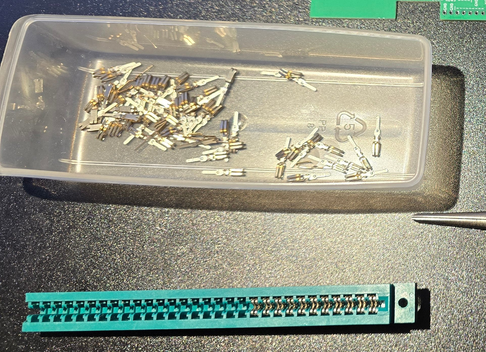
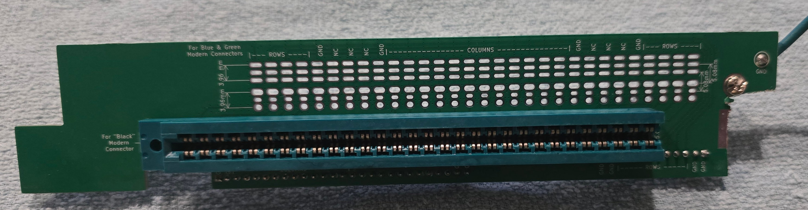
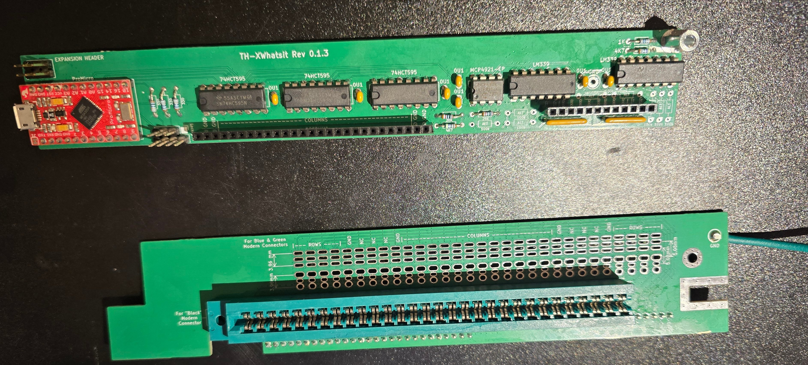
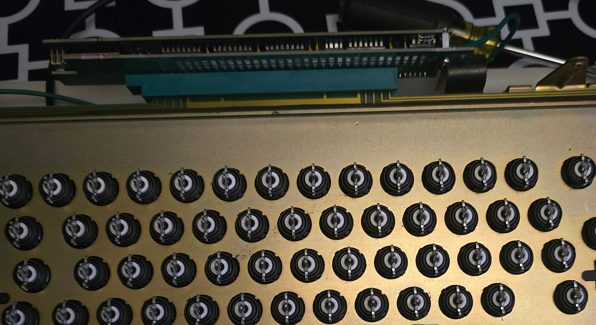
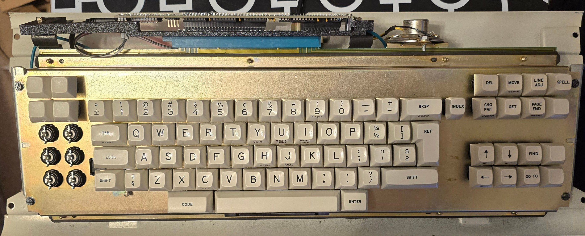
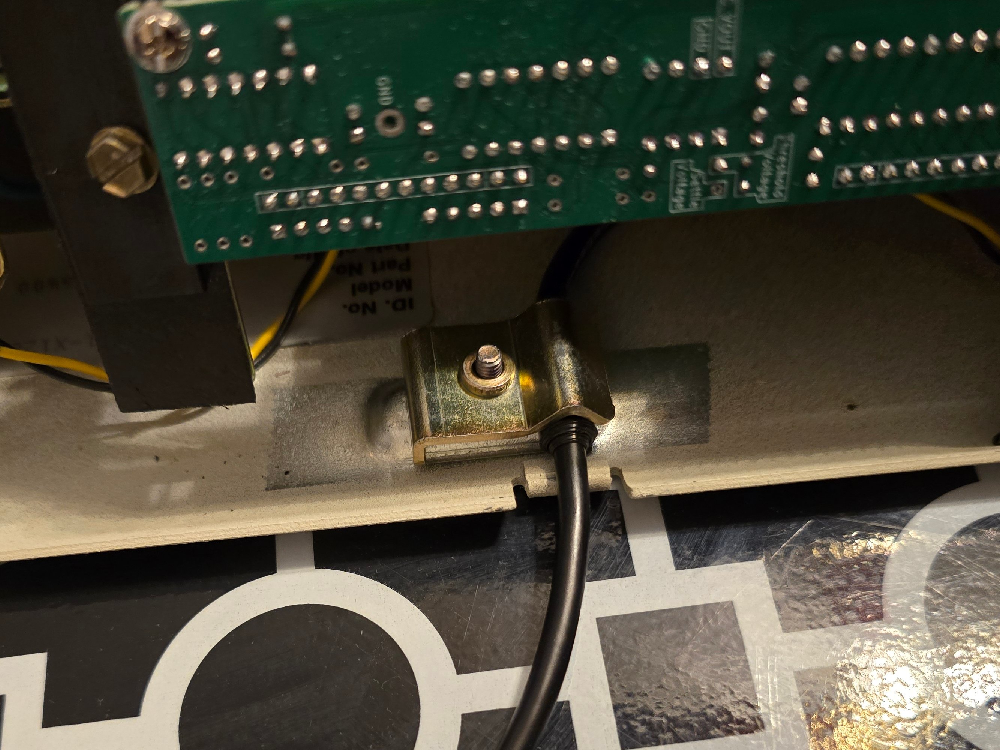
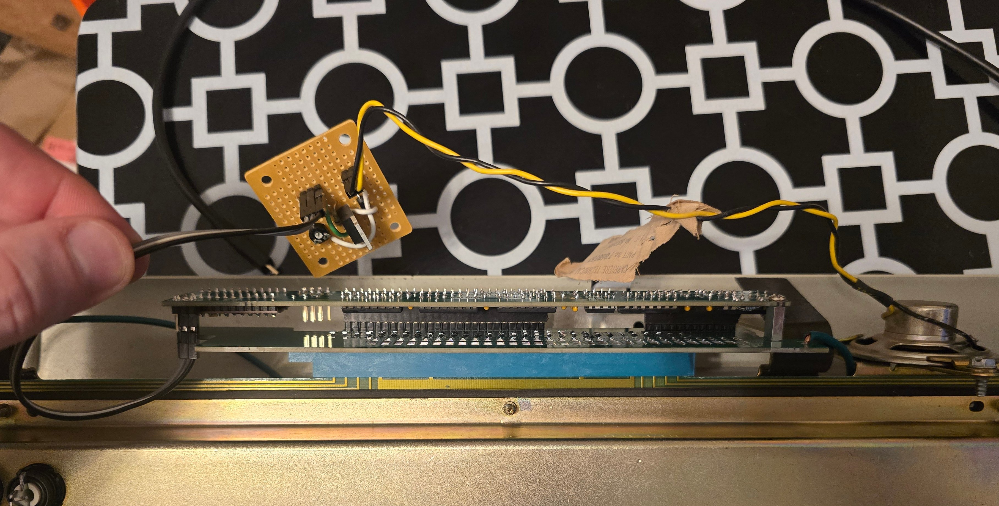

# DisplayWriter Restoration: Controller Assembly

At this point, I had the DisplayWriter fully mechanically restored.  All that remained was getting it working with a modern computer.

## Controller Selection

The DisplayWriter has 8 sense rows rather than the usual 4, so available standard xwhatsit controllers wouldn't work.  This left me with options:

- [A TH-xwhatsit controller](https://github.com/listofoptions/TH-XWhatsIt)
- [A Leyden jar controller](https://github.com/mymakercorner/Leyden_Jar)

Leyden jar controllers are newer; however, there's no documented support for DisplayWriters specifically.  It's possible I could get
it to work, but would probably take additional time, and would be more of a gamble.

The TH-xwhatsit controller explicitly supports DisplayWriters and comes with a plug board for the specific pinout.  It's a bit older,
and doesn't appear recently maintained; but is tried and true.

There may be a few other options as well; for example, I believe there's a DisplayWriter-specific variant of the original xwhatsit
controller; but these seem to be the best options.

I ended up going with TH-xwhatsit; I figured that would be the quickest and most reliable method for getting this working.
And I'll always have the option to swap it out in the future if I feel like it.

## Obtaining Components

PCBs were ordered from JLCPCB from the published gerbers and arrived without issue.

All the other needed components (aside from ones I had on-hand) were ordered from Mouser.  Most were easy to find; a few had to be
swapped out for equivalently-specced available equivalents.

## Card Edge Connector

The trickiest component is the card edge connector.  There seem to be a few possibilities, but availability and compatibility varies.

I ended up going with a EDAC 307-086-520-202.  This connector needed to be modified in two ways to work:

- The connector has too many positions and needs to be cut to length
- The connector is designed for thicker PCBs and needs to be "pin modded" to reliably contact the thin pad card

These procedures are both based on xwhatsit's original published instructions, modified for this specific connector.

First, remove all pins from the connector.  Grab each pin from the bottom with pliers and push up towards the top.  Once the pin has
been dislodged, it can be pulled out from the top.

Once all pins are removed, the connector can be cut to length.  Carefully count the number of positions to match the pad card edge,
then cut through the middle of the next adjacent position.  I used a band saw.  A mask is highly recommended.  Clean up any
rough edges with a file and make sure there's no debris in the connector.

Then each pin needs to be pin-modded to handle the thinner PCB.  This connector is a bit different from the one described in
xwhatsit's original instructions.

The prongs on the pin need to be bent toward the center, perhaps by an additional 15 angular degrees or so.

The "second bend" described in xwhatsit's instructions may not apply to this connector, or at least not for the same reasons.  On this
connector, a second bend in the pin does exist, but its purpose is to prevent digging into the PCB on removal.  As long as
this second bend still bends backwards from the connector centerline, it should be OK.  I did end up bending most of them backwards
just a little bit more to be safe.

After modding the pins, they can be inserted back into the (now-shortened) connector.  Pop them in from the top, then grab with pliers
from the bottom and pull until seated.

I bent the pins just enough so that opposite pins touched each other without a PCB inserted.  This might be a bit on the tight side; but
it did provide an easy way to check that the pins were bent enough, both visually and with a continuity tester.  Do this at your own risk; a connector that's too tight could potentially damage the pad card.

## Cutting the Plug Board

The TH-xwhatsit controller comes with a plug board specific to the DisplayWriter.  But depending on the card edge connector, and possibly
specifics of the keyboard, it might not actually fit out of the box.

In my case, after I already got everything soldered together and attempted to connect the plug board, I discovered that it did not
actually fit.  The plug board was impacting one of the original controller support brackets.

To make it fit, I had to cut a corner off the plug board PCB.  I definitely recommend doing this *before* soldering everything together,
and checking to make sure everything else fits.  Fortunately, there were no traces in the area I had to remove.

I used an oscillating multitool with a diamond blade to cut the PCB.  This probably wasn't ideal; a rotary tool of some sort would
likely be better.

When I first made these cuts after everything was soldered together, I actually lost a row and failed the first round of testing.
Cutting it probably cracked a solder joint or broke a trace.  Re-wetting each solder joint with fresh flux didn't help, so I ended
up just remaking the board (I had spares from the JLC minimum order quantity) and got nicer cuts the second time around.

## Assembling the Controller

Soldering everything together was pretty straightforward following the silk screen on the PCB.  I did end up including an
extra unnecessary shift register (the DisplayWriter has fewer columns than most so technically only needs 2) since it
wasn't immediately clear which one could be left off, and I had spares.  It *is* critical to include the second comparator
to handle the DisplayWriter's additional rows.

This photo is pre-plugboard-cut (I didn't notice the fit issue until later).

There are a few different locations where the ground can be installed on the PCBs; only one needs to be connected
I chose to solder a wire to the ground terminal on the plug board.

It should go without saying, but remember to clean up your flux :)

## Connecting the Controller

The plug board and controller main board attach to each other with pin headers and a standoff with screws.  When attaching them to
the pad card, I recommend initially keeping them separate.  Screw the standoff into the plug board, then push just the plug board
onto the pad card edge.

When pushing the connector onto the card edge, be very careful.  It can take a fair amount of force, and the connector isn't
self-aligning.  Line up the contacts on the card edge connector with the contacts on the card, then gently lever it on
side-to-side, taking care to ensure the contacts stay aligned.

Ensure the board is connected in the proper orientation.  The TH-xwhatsit boards can be assembled in a couple different
configurations.  In the configuration I used, the right orientation is with the plug board top silk screen facing the front of
the keyboard with the text right-side-up.

After the plug board is connected, the controller main board can be attached.  Push it onto the plug board pin headers and
attach it to the standoff with a screw.

The ground wire can be attached to any of the screw points on the base pan.  I crimped on a fork terminal and attached it to
a threaded hole on the case that was originally connected to a second cord clip.  The ground wire needs to be a bit long to
reach this point, but it doesn't seem to cause any issues, and simplifies some maintenance.

At this point, the controller is just hanging off the card edge, not supported by anything else.  This isn't necessarily a problem -
the controller doesn't weigh much - but it could potentially be a problem if it ever suffers another impact that puts additional
force on the card edge.  I decided to make a simple 3d printed bracket that clips onto the top of the plug board PCB and screws
onto the original mount points for the controller.

The micro USB cable can now be connected to the controller and routed to the strain relief clip and out the back of the case.  The
cable I used wasn't thick enough to be held securely by the strain relief, so I wrapped that section in electrical tape for a better grip.

## Enabling the Speaker

Connecting up the speaker is entirely optional.  I decided to get it working just for completeness; and I actually like the sound
more than I expected.

My understanding is that the original behavior for this speaker was to make a brief 'click' on key press.  The TH-xwhatsit board
includes an expansion header, primarily intended for operating a solenoid via a controller.  But the same signal can be used to
control the speaker as well via a simple driver.

I cobbled together an extremely basic driver out of random components I had on some perf board.  Pretty much a MOSFET, potentiometer,
diode, couple of resistors.

This is by far the jankiest part of this restoration project, and at some point I may get a proper PCB made for the purpose.  For now,
I connected it up, covered the back of the perfboard with electrical tape, and wedged it under the controller board with another
3d printed clip.

