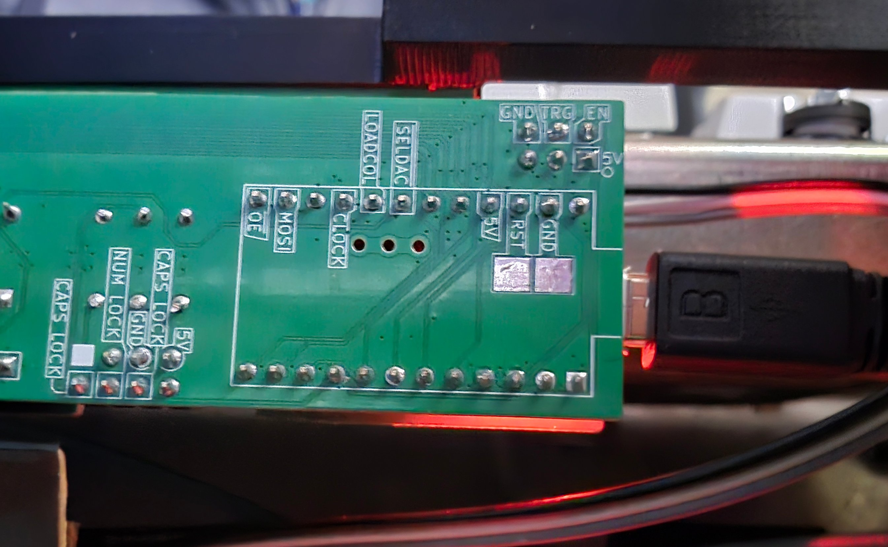

# DisplayWriter Restoration: Firmware and Key Map

For the TH-xwhatsit controller, it looks like there are a few different branches of firmware floating around.  After a bit
of research, I ended up using the `pandrew_wip` branch of [ploxiln's qmk fork](https://github.com/ploxiln/qmk_firmware).
This seems to be the most recently maintained stable branch with confirmed DisplayWriter compatibility.  The branch hasn't
been updated in a few years, but it seems to work fine.

I'm a Linux user, so some of the process documented here is Linux-specific.  Some has cross-platform applicability.

Note: All instructions here are specific to my system and the hardware components I used.

## Compiling the Firmware

Clone the [repository](https://github.com/ploxiln/qmk_firmware) and check out the `pandrew_wip` branch.  It has a few git
submodules that need to be installed.

There are a few python dependencies that need to be installed (`pip install -r requirements.txt`).  It may be helpful to
set this up inside of venv.

The firmware with the DisplayWriter configuration can be compiled with:

`make xwhatsit/ibm/displaywriter/universal:default`

## Loading the Firmware

It can be helpful to watch system activity for connected USB devices.  On Linux, this is typically done with `dmesg -w`.

On Linux, `avrdude` is used to load the firmware.  But before it can be loaded, the controller has to be reset into
the bootloader.  The easiest way to do this is probably to use the `RST` and `GND` pads provided on the back of
the controller PCB.



To reset the controller and enter the bootloader, plug in the USB cable, then short the square RST and GND pads
together (I used tweezers).  Short them together twice in rapid succession.

If it worked, the controller will enter the bootloader for only a few seconds, so have the command to flash it
ready.  When it enters the bootloader, the `dmesg` readout should show a `/dev/ttyACM0` (or similar) device
connected.

The command to flash the firmware is:

`avrdude -p atmega32u4 -c avr109 -P /dev/ttyACM0 -b 57600 -U flash:w:xwhatsit_ibm_displaywriter_universal_default.hex:i`

This command is specific to the AVR/ProMicro used with TH-xwhatsit.  If the USB serial device is something other than
`ttyACM0`, use the appropriate device name.  The filename will also be different if using a keymap other than `default`.

If successful, the firmware should flash, and the controller should reboot as a functional keyboard!  I'd suggest
skipping the key-testing for now though and going straight to the diagnostic utility to confirm everything's
working.

## The Pandrew Diagnostic Utility

The firmware repository also contains a diagnostic utility for xwhatsit controllers that is very helpful in confirming
everything's functioning and debugging issues.

The utility uses Qt so will need the Qt dev dependencies installed.

The utility code is in the directory: `cd keyboards/xwhatsit/util/util`

Compile it with `qmake util.pro` then `make`.  It can then be run with `./util`.

On Linux, you may run into permission issues with the utility accessing the USB device.  You can either run it as root,
or add a udev rule like the following to `/etc/udev/rules.d/70-xwhatsit.rules`:

```
SUBSYSTEM=="usb", ATTR{idVendor}=="0481", ATTR{idProduct}=="0002", TAG+="uaccess"
```

(And reload with `sudo udevadm control --reload-rules`.)

The most useful initial tools are probably the signal level monitor and the key press monitor.  Make sure the signal
levels are all in a consistent range and that all the keys actuate correctly.

In my case, I actually had a dead row.  (If you find multiple keys not working, switch to the matrix view to see if
they're all in the same row or column.)  It was easy enough to track down to a broken connection on the plug board.

## Key Mapping

I wasn't a big fan of the default DisplayWriter keymapping.  Luckily, this runs QMK, so it's easy enough to create
your own.  This branch has no VIA/Vial support though, so changing the keymap requires editing a source file and
recompiling the firmware.

I uploaded the configuration I ended up using [here](https://github.com/CrispyConductor/qmk_firmware_ploxiln/tree/pandrew_wip_crispyconductor/keyboards/xwhatsit/ibm/displaywriter/keymaps/crispyconductor).

The layout I'm currently using is as follows:

*Base Layer:*

- Most alphanumeric keys work as expected.
- LOCK, SHIFT, Paragraph, CODE, and ENTER are used for the modifiers Ctrl, Shift, Super, Alt, and Fn; respectively.
- Nonstandard punctuation is roughly mapped positionally.  The 'degree' key becomes backtick/tilde, the fraction and bracket
  keys become the usual brackets, and the superscript key becomes backslash.
- The upper-right key block becomes a standard nav cluster; the remaining 2 keys are Print Screen and App Context.
- The lower-right key block is mapped to a T-nav; the remaining 4 keys are media/volume controls.
- There are 2 positions for Esc; the 'INDEX' key (otherwise unused, but not in the usual position) and the upper-right key of
  the left-hand key block.

I was conflicted about what to do with the left-hand key block.  The most obvious mapping is for the function keys F1-F10.
However, I use F11 and F12 at least as much (and would prefer a consistent access pattern); and using one of these keys
for Esc better matches the expected position.  I ended up using the Fn layer for function keys (which maps both the number keys
to F1-F12 and the left-hand keys to F1-F10) so I could put Esc in the left-hand block.  The lower 4 rows of the left-hand
block are mapped to F13-F20 for software-defined functions.

*Original-Function-Inspired Layer:*

Even though I'm using this with a modern computer, I still think a number of the legends are cool and unique.  I wanted to
preserve at least a little of that, so I created a toggle-able layer (Fn+H) that maps to historically-inspired functions.
For the moment, this maps the special characters to unicode escape sequence macros, changes arrow keys to match what is
shown on the legends, enables the caps-lock functionality, and a few other misc functions.

*Fn Layer:*

This enables function keys with both the number keys and the left-hand block (F1-F10).  It also maps a handful of keys
to other functions like toggling the solenoid, an actual caps lock, scroll lock, pause.  Fn+F toggles on a persistent
function-key layer for the left-hand key bank and Fn+H toggles the original-function-inspired layer.

A few internal functions are also under an additional layer.  Fn+Space+R resets to bootloader and Fn+Space+E erases the EEPROM.


