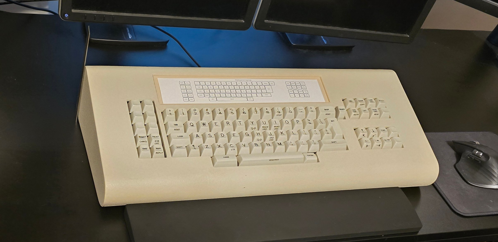
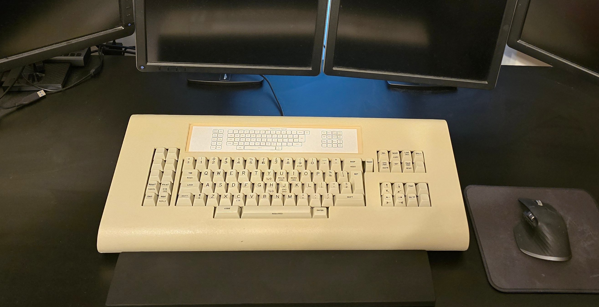
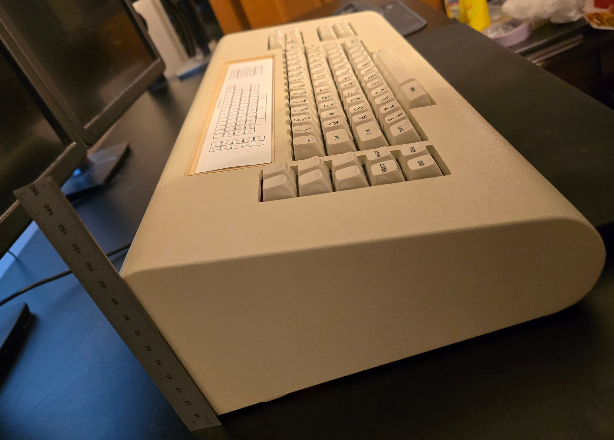
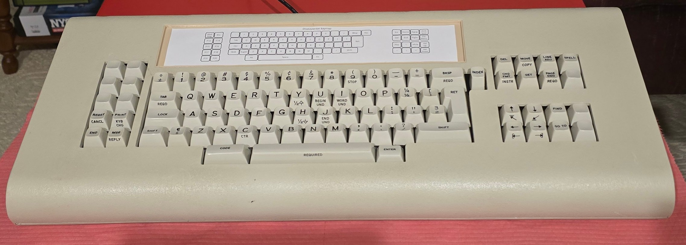

# A Newly-Restored DisplayWriter!

Aaaaand ... done!  Sort-of.  For now.

## The Results

This turned out much better than I had originally planned.  Well, I did end up putting a lot more time into it than
I'd originally planned; but it appears to have paid off.

I think this turned out quite well.  It looks good, feels good, sounds good, and works well.

It still isn't perfect.  The remaining defects are minor, but present:

- The small chip in the side of the space bar is still there; but not even visible in normal use.
- The crack in the case is still slightly visible if looking for it.  (But can't feel it with a fingernail and seems solid.)
- There's a persistent black mark on the front of the case and a couple scratches, likely from the drop.
- The color of the 3d printed card cover isn't a perfect match.
- Not all switches feel exactly the same or are perfectly smooth.  But even the ones that aren't perfect are perfectly
  usable, and differences generally aren't noticeable unless carefully feeling for it.  Regardless, there were plenty
  of near-"perfect" switches to use for all common keys and all keys larger than 1U.
- There's no contamination shield anymore, so keeping it clean during use is mandatory.

Of the original 84 switches, after restoration, 83 functioned correctly (with varying degrees of subjective smoothness
and behavior).  The one switch with a fractured beam spring became a parts donor for other damaged components.  One
additional switch (the caps lock switch) isn't usable for my purposes because it intentionally lacks a spring.

Despite this success, I ended up swapping in 9 of the 10 spares.  This is less out of necessity and more about
consolidating all the best-performing and most-durable switches onto the active keyboard.  I plan to keep the remainders
as spares; possibly for future projects.

## Subjective Thoughts (Beam Springs Ooh La La)

For me, this was the big point of curiosity, being my first ever experience with beam spring switches.  I intentionally
avoided playing with the switches on arrival in case they contained grit that could damage them.

I'm doing my best to be objective about the feel and experience; though of course, objectivity is a bit more difficult
on the heels of hundreds of hours sunk into a project like this.  For context, my switch experience to date has
primarily involved membrane buckling springs (both IBM and Unicomp) and various modern Cherry-mount clicky switches.

In a word, these switches are excellent - and in my opinion, the work was worth it.

The reviews I've read of them aren't kidding - beam spring switches really are unlike anything else I've tried, and I
immediately feel like I don't want to go back to anything else.  The mechanism feels extremely "clean" and "sharp", like the
quintessential example of what a keyboard switch should be.  Typing feels almost effortless.  Aside from the type
feel, the switch sound is quite nice too.

On the DisplayWriter in particular, the space bar stabilizer does sound a bit clattery.  I've found references to IBM
using grease at some of the interfaces here to prevent this, and I'll likely do the same, but I'm holding off until
I find a sure-fire way to prevent the grease from migrating anywhere I don't want it.

A common complaint about these boards is their height and typing angle.  Interestingly, neither bothers me at all.
I'm using a thick silicone wrist rest with it that helps to compensate for the height; and using it, the added
height is barely noticeable.  The typing angle also isn't an issue for me.  I'm used to flatter typing angles,
but I actually kind-of like the steeper angle on this.

Something that surprised me is that I actually like the speaker in it.  I didn't expect to; in fact, at first,
I was thinking I would have preferred a solenoid.  But the speaker has been growing on me.  A solenoid has the "cool"
factor, but I doubt many people actually have it turned on for normal use.  The speaker click on the other hand
is mild and unobtrusive.  It unifies perfectly with the switch sound to the point it's difficult to distinguish;
rather, it acts to subtly alter the switch sound in a way that sounds natural.  It's hard to describe; but I'd
almost say it makes the switches sound slightly "clackier".

The only hurdle is the layout.  I have it mapped to something very close to a modern layout, but there are still
a couple of places where I'm making mistakes.  This is particularly common with the different locations for the
Ctrl and Backslash keys; and sometimes with the arrow keys as well.

But I do plan to use this as a primary daily driver, and I expect to get used to it pretty quickly.  So far, the only
thing I've typed on it has really been this report.

## Next Steps

While this project is complete enough to "put it in service", there are still a couple of things I plan to
do; mostly working on a few of the minor complaints still present.

I plan to resolve the cosmetic visible hairline crack in the case and mismatched card insert color by simply
painting it.  The trick will be to find a perfect match color, which will almost certainly require a fair amount
of trial and error in mixing paints together.  I've obtained a few promising colors but haven't started trying
to find the right mix yet.

The big thing I want to resolve is the lack of a contamination shield.  Looking at other beam spring restoration posts, this seems like a nut which has yet to be satisfactorily cracked.

I know that people get along fine using these without shields; keeping them in pristine dust-free environments
and using dust shields when not in use.  But I want to use this as an actual keyboard, the same way I use any
other keyboard, without fear of a couple crumbs, a few loose hairs, or an errant splash destroying any of the
switch feel or other work I've spent so much time on.

The issue is, I'm also entirely unwilling to compromise on switch feel.  The whole point of this exercise was
to get the 'best' switch feel possible; and even the massive benefits of a contamination shield become more difficult
to justify if they work against the main goals.  I'd be willing to slightly compromise on switch sound, but only
very slightly; and only because I know that a contamination shield is realistically always going to have some effect.

Looking at other attempts, none really seem sufficient.  Most are based on various types and configurations of thin
flat material.

I've been working on a few experiments that are looking quite promising.  But that's a whole project on its own!

